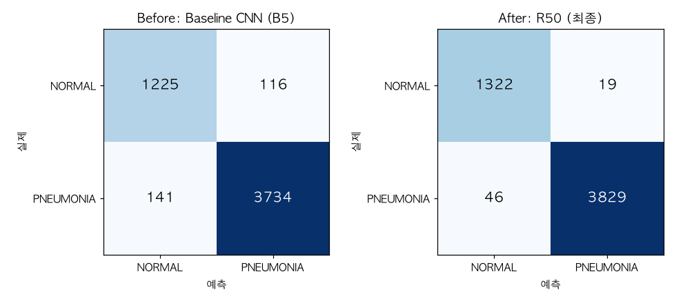
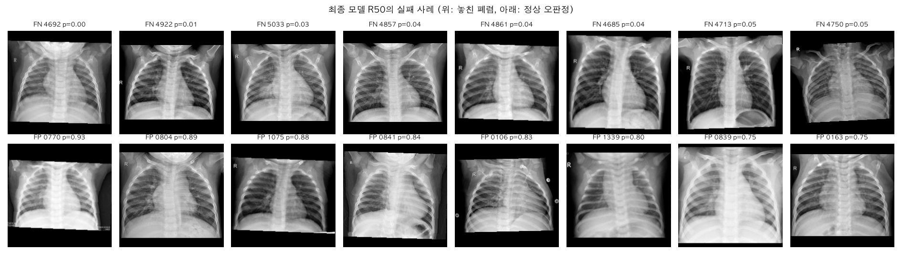
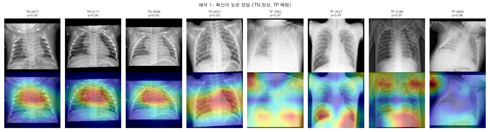
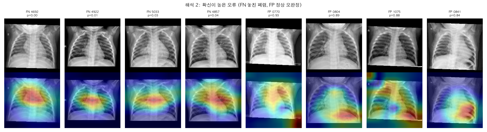

# Mission 0\~5 정리

[← README로 돌아가기](../README.md)

소아 흉부 X-ray를 정상(NORMAL)과 폐렴(PNEUMONIA)으로 분류하는 모델을 개발하고, 실험·분석·해석 과정을 Mission 단위로 정리한 문서이다.

> [!IMPORTANT]
> **최종 모델 R50** (ResNet50, 여백 크롭, 5-fold) · 리더보드 **0.8782** (548/624) · Baseline 0.75 대비 **+80장** · 목표 0.98 미달

| Mission | 주제 | 핵심 결과 |
|---|---|---|
| 0 | 문제 해결 전략 수립 | 가설 2개(입력 처리, 모델과 학습), 7단계 흐름, Accuracy + AUC |
| 1 | 데이터 이해와 Baseline | train 5,216장(폐렴 74%), Baseline 리더보드 0.75 |
| 2 | 개선 전략 설계 | 전처리(letterbox, 여백 크롭, 증강), 모델(ResNet18, DenseNet121, 앙상블) |
| 3 | 실험 수행과 검증 | 개선 실험 14개, 최종 R50 리더보드 0.8782 |
| 4 | 결과 분석 | 가설 2 채택(p≈10⁻³⁵), 가설 1 기각 못 함(p=0.73), 실패 사례 분석 |
| 5 | 모델 해석과 서비스 설계 | Grad-CAM, 결과 데이터 6개 항목, 위험도 3단계 |

### 목차

- [Mission 0. 문제 해결 전략 수립 (Flow Planning)](#mission-0-문제-해결-전략-수립-flow-planning)
- [Mission 1. 데이터 이해 및 Baseline 구축](#mission-1-데이터-이해-및-baseline-구축)
- [Mission 2. 개선 전략 설계 (실험 전 계획)](#mission-2-개선-전략-설계-실험-전-계획)
- [Mission 3. 실험 수행 및 검증](#mission-3-실험-수행-및-검증)
- [Mission 4. 결과 분석](#mission-4-결과-분석)
- [Mission 5. 모델 해석 및 서비스 확장 설계](#mission-5-모델-해석-및-서비스-확장-설계)

---

# Mission 0. 문제 해결 전략 수립 (Flow Planning)

## 성능 개선 가설

| 가설 | 귀무가설 (H0) | 대립가설 (H1) | 근거 |
|---|---|---|---|
| **가설 1**<br>입력 처리 | 비율을 유지하는 전처리를 train과 test에 똑같이 적용해도, Baseline의 128×128 강제 Resize와 정확도 차이가 없다. | 비율을 유지하는 전처리를 train과 test에 똑같이 적용하면 정확도가 높아진다. | 강제 Resize는 흉곽 비율을 왜곡하고, 원본 크기가 제각각인 test와 train의 입력 형태를 다르게 만든다. |
| **가설 2**<br>모델과 학습 | ImageNet 사전학습 모델로 충분히 학습해도, 2층 CNN을 2 epoch 학습한 Baseline과 정확도·AUC 차이가 없다. | ImageNet 사전학습 모델로 충분히 학습하면 정확도와 AUC가 높아진다. | Baseline은 모델이 작고 학습량이 적어서 과소적합될 가능성이 크다. |

**검정 방법**: 같은 fold 분할에서 두 조건의 예측을 McNemar 검정으로 비교하고, p<0.05이면 H0을 기각한다.

## 문제 해결 전체 흐름

1. 데이터 구조와 클래스 분포 확인
2. 샘플 이미지로 전처리 필요성 확인
3. Baseline 학습 및 리더보드 점수 기록
4. 검증 데이터 분리 (train에서 Stratified K-Fold)
5. 전처리와 모델을 단계적으로 바꾸며 실험 (ResNet18 → 다른 모델)
6. 가장 좋은 모델로 test 예측 후 제출, 로그 기록
7. 결과 분석 (실패 케이스, Grad-CAM)

## 평가 지표

* **공식 지표: Accuracy.** 대회 채점 기준이며 목표는 0.98 이상이다.
* **보조 지표: ROC-AUC, 클래스별 정밀도·재현율·F1.** 임계값과 관계없이 구분 능력을 보고, 어느 클래스에서 틀리는지 확인한다.
* 판정 임계값은 0.5로 고정한다. test 결과를 보고 바꾸지 않는다.

## Reflection

<sub>질문을 누르면 답변이 펼쳐집니다.</sub>

<details>
<summary><b>전체 접근 흐름</b></summary>

데이터 구조와 클래스 분포를 먼저 확인해 전처리 필요성을 파악하고, Baseline 점수를 기준값으로 기록했다. 그다음 검증 체계를 만들고 전처리와 모델을 단계적으로 바꾸며 실험한 뒤, 결과를 분석하는 순서로 설계했다. 검증 없이 바꾸면 무엇이 효과를 냈는지 판단할 수 없기 때문이다.

</details>
<details>
<summary><b>평가 지표 선택 이유</b></summary>

대회가 Accuracy로 채점하므로 목표 지표로 정했다. 하지만 PNEUMONIA가 74%인 불균형 데이터라서 PNEUMONIA만 예측해도 약 74%가 나온다. 그래서 AUC와 클래스별 지표를 함께 보기로 했다.

</details>
<details>
<summary><b>Baseline 이전에 예상한 문제</b></summary>

Baseline 코드를 보고 다섯 가지를 예상했다. 검증 없음, 128×128 강제 Resize로 인한 비율 왜곡, 작은 모델과 2 epoch로 인한 과소적합, 클래스 불균형 미고려, 정규화와 증강 부재이다.

</details>
<details>
<summary><b>먼저 적용할 전략과 이유</b></summary>

검증 체계를 가장 먼저 만들고, 그다음 전처리를 개선한다. 검증이 있어야 변화를 비교할 수 있고, 입력이 왜곡된 상태에서는 모델을 바꿔도 공정하게 비교하기 어렵기 때문이다.

</details>
<details>
<summary><b>실험 결과 검증 방법</b></summary>

같은 fold 분할과 seed로 OOF 정확도와 AUC를 비교한다. 차이가 우연인지는 McNemar 검정으로 확인한다. 최종 판단은 Baseline 리더보드 점수(기준값)와 비교한다. test 데이터는 제출 파일 생성에만 쓴다.

</details>

---

# Mission 1. 데이터 이해 및 Baseline 구축

## 데이터 구조 및 클래스 분포

* train: 5,216장, 224×224 흑백, letterbox 처리됨. 라벨 있음.
* test: 624장, 원본 해상도가 제각각. 라벨 없음.
* 클래스 분포: NORMAL 1,341장(25.7%), PNEUMONIA 3,875장(74.3%)

## 샘플 이미지 확인

* NORMAL과 PNEUMONIA 샘플을 나란히 보며 확인했다. 테스트 이미지는 train과 비율이 다르다는 것을 확인하고, letterbox 전처리를 적용했다.

## Baseline 모델

```yaml
model:      2-layer CNN        # Conv(16) → Conv(32), 각각 ReLU + MaxPool → Flatten → FC(32·32·32 → 2)
input:      grayscale, Resize(128×128), ToTensor   # 정규화·증강 없음
optimizer:  Adam(lr=1e-3)
batch_size: 32
epochs:     2
validation: none
```
> [!NOTE]
> **Baseline 리더보드 0.75** (약 468/624장 정답). 목표 0.98 대비 약 0.23 부족하며, 검증 점수는 측정되지 않았다.

* 참고로 ResNet18(fold 0) 리더보드 점수는 0.84455이고, 방법 A(5-fold)는 0.8621794872이다.
* 예측 분포: NORMAL 57%, PNEUMONIA 43%로 train 분포(NORMAL 26%)와 크게 다르다.

## Reflection

<sub>질문을 누르면 답변이 펼쳐집니다.</sub>

<details>
<summary><b>평가 지표</b></summary>

Accuracy가 대회 채점 기준이라 적절하다. AUC는 임계값에 의존하지 않고 모델이 두 클래스를 얼마나 잘 구분하는지 보여 준다. 그래서 Accuracy와 함께 본다.

</details>
<details>
<summary><b>불균형 데이터의 문제</b></summary>

모델이 다수 클래스(PNEUMONIA)만 맞혀도 정확도가 높게 나온다. 데이터의 74.3%가 PNEUMONIA이므로 모두 PNEUMONIA로 예측해도 정확도가 약 74%이다. 그래서 정확도만으로는 모델이 실제로 학습했는지 알 수 없다.

</details>
<details>
<summary><b>불균형 확인 방법</b></summary>

`value_counts()`로 라벨 분포를 세어 확인했다.

</details>
<details>
<summary><b>Baseline의 가장 큰 한계</b></summary>

검증 과정이 없어서 모델 성능을 알 수 없다. 구조도 얕고 2 epoch만 학습해서 과소적합 가능성이 크다.

</details>
<details>
<summary><b>개선 방향</b></summary>

검증 데이터 분리, letterbox 전처리, 사전학습 모델, 클래스 가중치와 증강 적용.

</details>

## 문제점 (2가지 이상)

1. 검증 없이 학습해서 성능을 측정할 수 없음
2. 128×128 Resize로 흉곽 비율이 왜곡되고 train과 분포가 달라짐
3. 2 epoch의 얕은 구조라 과소적합 가능성이 큼
4. 클래스 불균형(74:26)을 고려하지 않음

## 개선 방향 가설

Mission 0의 가설 1, 2와 같다.

---

# Mission 2. 개선 전략 설계 (실험 전 계획)

## 전략 요약

| 구분 | 전략 | 개선 영역 | 해결하려는 문제 |
|---|---|---|---|
| 전략 1 | 데이터 전처리 (letterbox, 여백 크롭, 증강) | 데이터 | train과 test의 입력 형태 차이, 적은 학습 데이터 |
| 전략 2 | 모델 변경 (ResNet18, DenseNet121, 앙상블) | 모델 | 단일 구조의 한계와 분포 변화에 대한 불안정성 |

공통 학습 설정(클래스 가중치, label smoothing 0.05, AdamW + Cosine LR)은 전략 1·2와 함께 유지한다. 이 설정은 학습 방식을 개선하며, PNEUMONIA 비율(74%)에 따른 쏠림과 과신을 줄이기 위한 기본 조건이다.

---

## 전략 1. 데이터 전처리

**1-1. letterbox (비율 유지 + 검은 패딩)**

baseline은 128×128로 강제 Resize하면서 흉곽 비율을 왜곡했다. 이 전략은 입력 비율을 유지한 채 224×224에 맞춰서 흉곽 형태가 왜곡되지 않도록 한다. Mission 1에서 확인한 대로 train은 이미 224×224 letterbox 형태(위·아래 여백 100%)이고 test는 원본 비율이므로, 학습과 test에 같은 방식을 적용해야 입력 분포가 맞는다. 이 전략은 데이터의 입력 형태를 개선하며, 모델이 같은 형태의 입력에서 학습하도록 만든다. 제외한 대안으로는 강제 Resize(비율 왜곡), 중앙 크롭(흉곽 가장자리와 폐 하단의 병변을 잘라낼 위험)이 있다.

**1-2. 검은 여백 크롭 (임계값 기반 바운딩 박스)**

train의 내용 비율(영역 안에서 실제 내용이 차지하는 비율)은 0.663으로 낮아, 흉곽이 프레임의 상당 부분을 차지하지 못한다. test와 프레이밍이 다르므로, train의 여백을 먼저 제거해 프레이밍 차이를 줄인다. 이 전략은 입력 형태를 개선하는 데이터 전처리이다. 임계값은 train에서만 정하고 test에는 같은 규칙을 적용하므로, test 정보가 학습에 흘러 들어가지 않는다. 다만 프레이밍이 맞아진다고 검증 점수가 오른다는 보장은 없다. 검증 데이터가 train과 같은 분포이기 때문에, 이 효과는 test 쪽에서만 드러날 수 있다. 제외한 대안으로는 병변 ROI 크롭(병변 좌표가 데이터에 없어서 불가능)과 외부 폐 분할 모델을 이용한 크롭(외부 데이터 사용 규칙에 저촉될 우려)이 있다.

**1-3. 데이터 증강 (회전·이동·확대·밝기/대비)**

5,216장은 적은 편이라 모델이 학습 이미지를 외울 위험이 있다. 증강으로 입력 변형을 늘려 일반화를 돕는다. 이 전략은 데이터의 다양성을 늘리는 것이며, 모델 구조와 학습 설정은 바꾸지 않는다. 흉부 X-ray는 과한 변형이 해부학적 구조를 왜곡하므로 범위를 작게 잡는다. 회전은 ±10° 이내, 이동과 확대는 미세한 수준, 밝기·대비는 가벼운 변화만 허용한다. 좌우 반전은 제외한다. 심장이 왼쪽에 치우쳐 있고 'R' 마커가 있어서, 반전하면 해부학적 구조와 마커가 뒤집혀 test와 분포가 달라진다. 범위를 넓게 잡는 방식도 같은 이유로 제외한다.

---

## 전략 2. 모델 변경

**2-1. ResNet18 (ImageNet 사전학습)**

파라미터가 약 1,100만 개로 가볍고 M1 Pro에서 epoch당 약 34초로 빠르게 실험할 수 있다. 사전학습 전이학습의 표준적인 출발점이므로, 이후 모델을 비교하는 기준으로 적합하다. 이 전략은 모델 구조를 정하는 것이며, 사전학습 가중치로 적은 데이터에서도 특징을 안정적으로 추출하도록 돕는다. 제외한 대안으로는 ResNet50 등 더 큰 모델이 있다. 파라미터가 크면 5,216장 데이터에서 과적합 위험이 커지고, 학습 시간도 길어진다.

**2-2. DenseNet121 (ImageNet 사전학습)**

DenseNet은 각 층이 앞선 층의 특징을 모두 연결해서 재사용하는 구조다. 이 특성은 작은 데이터에서도 특징을 효율적으로 쓰는 데 유리하다고 알려져 있다. 연결 방식이 ResNet과 다르므로 같은 데이터에서도 다른 오류 패턴을 보일 가능성이 있고, 이것이 앙상블에서 장점이 된다. 이 전략은 모델 구조를 바꾸는 것이다. 제외한 대안으로는 EfficientNet과 ConvNeXt가 있다. 같은 조건에서 비교할 수 있지만, 실험 시간을 고려해 우선순위를 낮췄다. ViT는 데이터가 적어서 사전학습 없이는 불리하므로 제외한다.

**2-3. 앙상블 (ResNet18 + DenseNet121, 확률 평균)**

두 모델이 서로 다른 오류를 낸다면, 확률을 평균할 때 개별 오류가 줄어든다. 특히 분포가 바뀐 test에서는 한 모델의 치우친 판단이 완화될 수 있다. 이 전략은 모델 구성을 바꾸는 것이며, 추가 학습 없이 기존 결과를 조합하므로 비용이 작다. 각 모델을 5-fold로 학습한 뒤 fold별 확률을 평균한다. 제외한 대안으로는 단일 모델 중 최고 점수 모델만 쓰는 방식(분포 변화에 취약할 수 있음)과 같은 구조끼리의 앙상블(오류 패턴이 비슷해서 효과가 작음)이 있다. 앙상블 가중치를 test 결과로 고르는 방식은 누수에 해당하므로 쓰지 않는다. 순서는 DenseNet121을 fold 0에서 먼저 검증하고, 성능이 확인되면 5-fold 학습 후 앙상블한다.

---

## 적용하지 않을 전략과 제외 이유

* **해상도 확대(384 이상)**: train 원본이 224×224라서 입력을 키워도 새 정보가 생기지 않는다. 계산량만 늘어나므로 제외한다.
* **배치 크기와 epoch 튜닝**: 현재 메모리 문제가 없고, 고정 epoch에서 검증 점수가 안정적으로 수렴하므로 우선순위가 낮다.

---

## 전략별 분류

* **데이터**: letterbox, 여백 크롭, 증강
* **모델**: ResNet18, DenseNet121, 앙상블
* **학습 방식**: 클래스 가중치, label smoothing, AdamW + Cosine LR (공통 설정)

---

# Mission 3. 실험 수행 및 검증

## 실험 관리 방식

* **검증**: train.csv를 Stratified 5-fold(seed 42)로 나눠 fold마다 80%로 학습하고 20%로 검증한다. 5개 fold의 검증 예측을 모은 OOF(Out-of-Fold) 정확도와 AUC로 비교한다. 방법 A 이후에는 12 epoch를 고정하고 마지막 epoch 가중치를 쓴다.
* **비교**: 직전 기준에서 변경점 하나만 바꾸고, 같은 이미지에 대한 두 모델의 판정을 McNemar 검정으로 비교한다. 채택 기준은 OOF 정확도 +0.003 이상이면서 p<0.05이다.
* **test 예측**: 5개 fold 모델의 확률을 평균하고 임계값 0.5로 판정한다. 임계값과 가중치는 test 결과로 정하지 않는다.
* **기록**: 실험마다 노트북을 따로 만들고, 결과 파일에 단계 이름을 붙이며, 결과를 `analysis/실험기록.csv`에 한 줄씩 남긴다. 다른 실험의 결과 파일을 덮어쓰지 않는지 실행 전에 자동으로 검사한다.

## 실험 결과 (Baseline vs 개선 모델)

| 단계 | 변경점 | OOF 정확도 | OOF AUC | 놓친 폐렴 (FN) | 정상 오판정 (FP) | 리더보드 | 맞힌 장수 (624장) |
|---|---|---|---|---|---|---|---|
| Baseline | 해커톤 제공 CNN, 128×128 Resize, 2 epoch, 검증 없음 | - | - | - | - | 0.75 | 약 468 |
| ResNet18 fold 0 | 사전학습 ResNet18, letterbox, 증강, 클래스 가중치, fold 0, 최고 epoch 선택 | 0.9933 (fold 0, TTA 적용; 학습 로그 최고 epoch 0.9923, TTA 없음) | 0.9986 | - | - | 0.84455 | 약 527 |
| 방법 A | 12 epoch 고정, 5-fold OOF, 5개 모델 평균 | 0.9885 | 0.9991 | 47 | 13 | 0.8622 | 538 |
| S4 | 밝기·대비 증강 0.2 → 0.4 | 0.9891 | 0.9991 | 45 | 12 | 미제출 | - |
| C1 | 검은 여백 크롭(T=10) 후 letterbox | 0.9877 | 0.9991 | 51 | 13 | 0.8766 | 547 |
| D1 | 백본 DenseNet121 (C1 설정) | 0.9887 | 0.9981 | 38 | 21 | 0.8750 | 546 |
| EB0 | 백본 EfficientNet-B0 (C1 설정) | 0.9877 | 0.9992 | 51 | 13 | 0.8718 | 544 |
| E1(eq) | C1 + D1 앙상블, 동일 가중, 임계값 0.5 | 0.9893 | 0.9990 | 40 | 16 | 0.8718 | 544 |
| E1 | C1 + D1 앙상블, OOF 최적(DenseNet 0.8, 임계값 0.3) | 0.9912 (중첩 검증 0.9902) | 0.9986 | 21 | 25 | 0.8429 | 526 |
| F1 | layer2까지 고정 (C1 설정) | 0.9893 | 0.9986 | 43 | 13 | 미제출 | - |
| F2 | layer3까지 고정 (C1 설정) | 0.9864 | 0.9989 | 59 | 12 | 미제출 | - |
| P1 | 퍼센타일 대비 늘리기 (C1 설정) | 0.9872 | 0.9992 | 49 | 18 | 미제출 | - |
| O4 | Optuna 시도 4 파라미터 (C1 설정) | 0.9883 | 0.9992 | 43 | 18 | 0.8717 | 544 |
| O11 | Optuna 시도 11 파라미터 (C1 설정) | 0.9887 | 0.9992 | 42 | 17 | 0.8669 | 541 |
| **R50** | **백본 ResNet50 (C1 설정)** | 0.9875 | 0.9985 | 46 | 19 | **0.8782** | **548** |

* 맞힌 장수는 리더보드 점수 × 624로 계산했다.
* 방법 A 이후의 변형은 모두 직전 기준과 비교해 McNemar p가 0.30 이상으로, 검증에서 유의한 차이가 없었다. 앙상블(E1)은 OOF 정확도와 중첩 검증으로 비교했다. 개별 검정 결과는 아래 표와 같으며, 저장된 OOF 예측으로 다시 계산한 값이다(근거 파일: `analysis/mcnemar_results.csv`, 계산 스크립트: `analysis/mcnemar_all.py`).

| 변형 | 비교 기준 | 기준만 맞힘 | 변형만 맞힘 | 변형 OOF | 기준 OOF | p값 |
|---|---|---|---|---|---|---|
| S4 | 방법 A | 9 | 12 | 0.9891 | 0.9885 | 0.66 |
| C1 | 방법 A | 19 | 15 | 0.9877 | 0.9885 | 0.61 |
| D1 | C1 | 21 | 26 | 0.9887 | 0.9877 | 0.56 |
| EB0 | C1 | 23 | 23 | 0.9877 | 0.9877 | 1.00 |
| F1 | C1 | 19 | 27 | 0.9893 | 0.9877 | 0.30 |
| F2 | C1 | 30 | 23 | 0.9864 | 0.9877 | 0.41 |
| P1 | C1 | 21 | 18 | 0.9872 | 0.9877 | 0.75 |
| O4 | C1 | 18 | 21 | 0.9883 | 0.9877 | 0.75 |
| O11 | C1 | 15 | 20 | 0.9887 | 0.9877 | 0.50 |
| R50 | C1 | 27 | 26 | 0.9875 | 0.9877 | 1.00 |

> [!IMPORTANT]
> **Baseline 대비 개선**: 리더보드 0.75 → **0.8782**로 80장을 더 맞혔다. 목표 0.98(약 612장)에는 약 64장 부족하다.

## 하이퍼파라미터 탐색

* **학습률 탐색(LR range test)**: fold 0 학습 데이터에서 손실이 최소인 학습률은 3.4e-4, 가장 가파르게 줄어드는 학습률은 1.3e-5였다. 현재 C1의 3e-4는 안정 구간의 끝에 있다.
* **Optuna 탐색**: fold 0에서 20회(9회 완료, 11회 조기 중단) 탐색했다. 범위는 학습률 1e-5\~5e-4, weight decay 1e-5\~1e-2, label smoothing 0\~0.1, epoch 6\~12이고, 목표는 검증 log loss였다.
  * log loss는 label smoothing이 작을수록 유리해서, 상위 조합이 모두 label smoothing 0.005 이하로 치우쳤다.
  * 현재 C1 설정은 정확도 0.9923으로 상위권이었다. 학습률은 1e-4\~3e-4가 적절했고, 1e-5 수준은 성능이 낮았다. 7 epoch로도 12 epoch와 비슷한 성능이 나왔다.
  * 상위 두 조합(O4, O11)을 5-fold로 다시 확인했으나 C1과 유의한 차이가 없었고, 리더보드는 오히려 낮았다.

## 추가 검증 분석

**1. 여백 크롭 규칙 검증**
* 임계값 T=0\~10에서 train 크롭 영역이 변하지 않았다(안정 구간). test는 위·아래 가장자리에 여백이 없어 크롭이 거의 적용되지 않는다.
* 크롭 후 train의 내용 비율은 0.663에서 0.927로, 종횡비는 1.0에서 1.372로 바뀌어 test(0.953, 1.442)에 가까워졌다.

**2. 최근접 이웃 확인 (누수 점검)**
* 중심화한 특징 벡터의 중앙값 유사도는 검증 0.946, test 0.942로 비슷했다. 픽셀 상관계수 0.98 초과 비율은 검증 3.9%, test 7.2%였다.
* 검증 이미지가 학습 이미지와 중복되었다는 증거는 없었다. 다만 32×32 픽셀 비교로는 같은 환자의 다른 촬영본을 잡아내기 어려우므로, 환자 단위 누수는 배제할 수 없다.

**3. 소아 데이터 점검**
* 무작위 200장과 특징 공간 이상치 50장을 육안으로 점검했다. 작은 흉곽, 수평에 가까운 갈비뼈, 팔을 든 고정 자세, AP 촬영 표시 등 소아의 특징이 공통으로 보였고, 성인으로 보이는 이미지는 없었다. 이 판단은 비전문가의 육안 판단이다.
* 무작위 200장 중 성인이 0장이므로, 성인 비율은 95% 신뢰수준에서 약 1.5% 미만이다.
* 출처로 추정되는 공개 데이터셋 페이지(Mendeley Data, doi:10.17632/rscbjbr9sj.2)에는 흉부 X-ray의 연령 정보가 없다. 원본 데이터는 내려받지 않았다.

**4. 모델 간 오류 비교 (OOF)**
* ResNet18(C1)과 DenseNet121(D1)은 38장을 함께 틀렸다. ResNet18만 틀린 이미지는 26장(대부분 놓친 폐렴), DenseNet121만 틀린 이미지는 21장이다.
* EfficientNet-B0까지 세 모델이 모두 틀린 이미지는 32장이다. 구조와 관계없이 어려운 이미지이며, Mission 4의 실패 사례 분석 대상이다.

**5. C1 대비 test 예측 변경 방향과 리더보드 결과**

| 비교 | NORMAL → PNEUMONIA | PNEUMONIA → NORMAL | 리더보드 증감 (장) |
|---|---|---|---|
| 방법 A → C1 | 0 | 9 | +9 |
| C1 → E1(eq) | 3 | 0 | -3 |
| C1 → E1 | 21 | 0 | -21 |
| C1 → O4 | 3 | 0 | -3 |
| C1 → O11 | 6 | 0 | -6 |
| C1 → R50 | 4 | 5 | +1 |

> [!WARNING]
> **리더보드 기반 사후 분석**: 아래 해석은 공개 리더보드 점수로 test 일부의 정답을 간접적으로 추론한 것이다. 모델이나 임계값 결정에는 쓰지 않았다.

* 한 방향으로만 바뀐 경우, 리더보드 증감의 크기가 바뀐 장수와 같으므로 폐렴 판정을 늘린 변경에서 바뀐 이미지는 모두 틀렸고, 정상 판정을 늘린 변경에서 바뀐 이미지는 모두 맞은 것으로 추론된다. 이 표는 리더보드 점수로 test 일부의 정답을 간접적으로 추론하는 분석이다. R50처럼 두 방향이 섞인 경우는 개별 이미지의 정답 여부를 알 수 없고, 합계만 1장 늘었다. 검증에서는 놓친 폐렴(FN)을 줄이는 변경이 좋아 보였지만, test에서는 같은 방향이 손해였다.
* 이 결과로 임계값이나 판정 비율을 조정하면 리더보드에 맞추는 것이 되므로 조정하지 않았다.

## 최종 모델

```yaml
# R50 · 최종 모델
backbone:     ResNet50 (ImageNet pretrained, 전체 층 학습)
preprocess:   검은 여백 크롭(T=10) → letterbox 224×224
augment:      rotate ±10°, translate 6%, scale 0.9~1.1, brightness/contrast ±20%   # 좌우 반전 없음
loss:         CrossEntropy(class_weight, label_smoothing=0.05)
optimizer:    AdamW(lr=3e-4, weight_decay=1e-4) + warmup 1 epoch + Cosine LR
epochs:       12 (고정, 마지막 epoch 가중치)
cv:           Stratified 5-fold (seed=42)
inference:    5-fold 확률 평균 + 약한 TTA, threshold=0.5
```
* **성능**: OOF 정확도 0.9875, AUC 0.9985, 리더보드 0.8782(548/624)
* **선정 근거**: 대회 규칙에 따라 최종 채점 파일을 직접 고르는 단계에서, 제출한 모델 중 공개 리더보드 점수가 가장 높은 파일을 선택했다.
* **주의**: 검증에서는 C1(ResNet18)과 유의한 차이가 없었고(McNemar p=1.0), 리더보드 차이도 1장이므로, 이 선택은 공개 리더보드에 맞춘 선택일 수 있다. 검증 기준으로는 C1과 R50이 같은 수준이다. 최종 채점이 공개 리더보드와 다른 데이터로 이루어진다면 순위가 바뀔 수 있다. ResNet50은 ResNet18보다 파라미터가 약 2배이고 학습 시간이 약 2.4배이다. 목표 0.98에는 미달이다.

## Reflection 답변

<sub>질문을 누르면 답변이 펼쳐집니다.</sub>

<details>
<summary><b>Baseline 대비 성능이 개선되었나?</b></summary>

개선되었다. 리더보드 0.75에서 0.8782로 80장을 더 맞혔다. 개선의 대부분(+59장)은 첫 개선 단계(ResNet18 fold 0)에서 나왔고, 이후 방법 A(+11장), 여백 크롭(+9장), ResNet50(+1장)이 더해졌다.

</details>
<details>
<summary><b>성능 변화의 원인은?</b></summary>

첫 개선 단계는 검증 체계, letterbox 전처리, 사전학습 모델을 함께 도입해서 요소별 효과를 나눌 수 없다. 방법 A는 epoch 고정과 5-fold 평균이 함께 바뀌었다. 여백 크롭은 train과 test의 프레이밍 차이를 줄여 test에서 9장을 더 맞혔다. 이후의 변형(모델 구조, 증강, 층 고정, 대비 보정, 하이퍼파라미터)은 검증과 리더보드 모두에서 뚜렷한 개선이 없었다. 모델 구조를 DenseNet121, EfficientNet-B0, ResNet50으로 바꿔도 리더보드 차이는 C1 대비 3장 이내였다.

</details>
<details>
<summary><b>예상과 다른 결과의 이유는?</b></summary>

검증 점수(0.98\~0.99)와 리더보드(0.84\~0.88)의 차이가 모든 버전에서 유지되었다. 검증에서 좋아진 변경(특히 FN을 줄인 변경)이 test에서는 정상을 폐렴으로 잘못 판정해 오히려 점수를 낮췄다. train에서 나눈 검증 데이터는 test와 분포가 달라서, 검증 점수로 고르는 방식이 test에서 맞지 않았다.

</details>
<details>
<summary><b>Train/Validation 분리는?</b></summary>

train.csv를 Stratified 5-fold(seed 42)로 나눠 라벨 비율을 유지했고, 모든 실험에서 같은 분할을 썼다. 첫 실험 이후에는 epoch를 고정해 검증 데이터로 모델을 고르지 않았다.

</details>
<details>
<summary><b>데이터 누수는 없었나?</b></summary>

test 데이터는 예측과 제출 파일 생성에만 썼다. 크롭 임계값은 train에서만 정했고, 앙상블 가중치와 Optuna 탐색은 train의 검증 데이터만 사용했다. 임계값은 0.5로 고정했다. 외부 데이터로 학습하지 않았으며(ImageNet 사전학습 가중치 제외), 출처로 추정되는 원본 데이터는 내려받지 않았다. 첫 실험은 검증 점수로 최고 epoch를 골라 점수가 부풀려질 수 있었으나 방법 A에서 고쳤다. 최근접 이웃 확인에서 검증과 학습 이미지의 중복 증거는 없었다. 리더보드 점수는 최종 파일 선택, 가설 1 검정, 예측 변화 방향의 해석에 썼다. 뒤의 두 가지는 리더보드 점수로 test 일부의 정답 분포를 추론한 사후 분석이므로, "test는 제출 파일 생성에만 쓴다"는 원칙을 엄격히 적용하면 그 범위를 넘는다. 이 분석으로 모델이나 임계값을 바꾸지는 않았다.

</details>
<details>
<summary><b>실험을 체계적으로 관리한 방법은?</b></summary>

실험마다 노트북과 결과 파일을 따로 두고 단계 이름을 붙였다. 결과는 `analysis/실험기록.csv`와 데일리로그에 기록했다. 결과 파일이 덮어써진 일을 겪은 뒤에는, 실행 전에 덮어쓰기 여부를 자동으로 검사했다.

</details>

## 계획과 실제 진행의 차이

| 항목 | 계획 (Mission 0) | 실제 진행 |
|---|---|---|
| Baseline 기록 시점 | 데이터 확인 직후, 개선 실험 전에 기록 | ResNet18 fold 0을 먼저 제출(0.84455)하고, Baseline은 나중에 제출(0.75) |
| 검증·전처리·모델 도입 순서 | 검증 체계 → 전처리 개선 → 모델 변경 | 첫 개선(ResNet18 fold 0)에서 세 가지를 동시에 도입 |
| 단계별 비교 | 전처리와 모델을 단계적으로 바꾸며 비교 | 첫 개선은 묶어서 바꿨고, 방법 A 이후(S4, C1, D1, EB0, F1, F2, P1, O4, O11, R50)부터 검증 체계 위에서 하나씩 비교 |

* 첫 개선 단계에서 검증, 전처리, 모델을 함께 바꿨기 때문에, Baseline 대비 개선 효과를 요소별로 나눌 수 없다.
* 이 차이를 보완하기 위해 Baseline CNN을 같은 5-fold로 학습한 결과와, Baseline CNN에 letterbox만 적용한 결과를 추가로 비교할 계획이다.

## 실험 중 발생한 문제와 해결

1. 데이터 경로 변경으로 노트북이 실행되지 않음 → 데이터 폴더를 자동 탐색하도록 수정
2. 셀 교체 시 같은 셀의 함수가 삭제됨 → 함수 복원 후 재실행
3. 설정 변수 누락(`MODEL_NAME`) → 설정에 추가 후 재실행
4. 노트북 출력 잔존으로 이전 결과를 새 결과로 오인 → 출력을 모두 지우고 실행 완료 후 확인
5. 작업 폴더 전환 중 실행 스크립트 파일이 사라짐 → 스크립트를 다시 만들고 실행을 재시작

---

# Mission 4. 결과 분석

분석 노트북: `notebooks/experiments/폐렴_분류_모델_M4_가설검정_BaselineCNN.ipynb`, `notebooks/final/Mission4_결과분석.ipynb`
그림과 표: `analysis/m4/` (혼동행렬, 확률 분포, 실패 사례, 공통 오류, 오류 특징)

모든 지표는 OOF 예측(train 5,216장, 각 이미지를 학습에 쓰지 않은 fold 모델로 예측한 값)으로 계산했다. 임계값은 0.5이다.

## Before vs After 성능 비교

Before는 해커톤 Baseline CNN을 최종 모델과 같은 5-fold로 학습한 결과(B5)이고, After는 최종 모델 R50이다.

| 지표 | Before: Baseline CNN (B5) | After: R50 (최종) |
|---|---|---|
| 정확도 | 0.9507 | 0.9875 |
| AUC | 0.9868 | 0.9985 |
| 민감도 (실제 폐렴 중 폐렴으로 찾은 비율) | 0.9636 | 0.9881 |
| 특이도 (실제 정상 중 정상으로 맞힌 비율) | 0.9135 | 0.9858 |
| PPV (폐렴 판정 중 실제 폐렴 비율) | 0.9699 | 0.9951 |
| NPV (정상 판정 중 실제 정상 비율) | 0.8968 | 0.9664 |
| 놓친 폐렴 (FN) | 141 | 46 |
| 정상 오판정 (FP) | 116 | 19 |
| 리더보드 | 0.75 (원래 Baseline) | 0.8782 |



* 놓친 폐렴은 약 3분의 1로, 정상 오판정은 약 6분의 1로 줄었다.
* 리더보드의 Before 값(0.75)은 전체 데이터로 한 번 학습한 원래 Baseline의 점수이다. B5는 5개 fold 모델의 평균이라 원래 Baseline과 다를 수 있다.

## 가설 검정 (Mission 0)

> [!NOTE]
> **가설 2 (모델과 학습): H0 기각, H1 채택** · **가설 1 (입력 처리): H0 기각하지 못함**

**가설 2 (모델과 학습): H0 기각, H1 채택**

| 비교 | Baseline만 맞힘 | 개선 모델만 맞힘 | McNemar p |
|---|---|---|---|
| B5 vs 방법 A (ResNet18, 사전학습, 12 epoch) | 33 | 230 | 1.6×10⁻³⁷ |
| B5 vs R50 (최종) | 35 | 227 | 1.3×10⁻³⁵ |

* 사전학습 모델로 충분히 학습하면 정확도가 오른다는 대립가설을 채택한다. 다만 B5와 방법 A·R50은 사전학습 여부만이 아니라 모델 구조, 전처리(해상도 224, 여백 크롭), 증강, 학습 설정이 함께 다르다. 따라서 이 결과는 사전학습 모델 단독의 효과가 아니라, 개선된 전체 파이프라인이 Baseline보다 낫다는 근거로 해석해야 한다.

**가설 1 (입력 처리): H0 기각하지 못함**

* train 이미지는 이미 224×224 정사각형 letterbox라서, 128×128 강제 Resize(B5)와 letterbox(B5L)가 train에서는 똑같은 결과를 냈다(OOF 정확도 0.9507로 동일).
* test에서는 624장 중 206장의 예측이 달라졌다. 강제 Resize는 NORMAL을 311장, letterbox는 105장으로 예측했다. 전처리 차이가 test 예측을 크게 바꾼다.
* 차이가 test에서만 생기므로 OOF로는 검정할 수 없고, 리더보드 점수로 판단했다. 이 검정은 리더보드 점수로 test 일부의 정답 분포를 추론하는 사후 분석이다.

| 전처리 | 리더보드 | 맞힌 장수 | test NORMAL 예측 |
|---|---|---|---|
| B5 (128×128 강제 Resize) | 0.7837 | 489 | 311 |
| B5L (128×128 letterbox) | 0.7740 | 483 | 105 |

* 두 전처리의 예측이 다른 206장에서는 정답이 두 가지뿐이므로 반드시 한쪽만 맞는다. 점수 차이로 계산하면 B5만 맞힌 이미지는 106장, B5L만 맞힌 이미지는 100장이다. 이 값으로 McNemar 검정을 하면 p=0.73이다.
* letterbox는 오히려 6장 적게 맞혔고, 차이도 유의하지 않다. 따라서 "비율을 유지하는 전처리가 정확도를 높인다"는 대립가설을 채택할 수 없다.
* letterbox를 적용한 Baseline CNN은 test를 대부분 폐렴(519장)으로 예측했다. Mission 3에서 확인한 "폐렴 판정을 늘리면 test 점수가 내려간다"는 경향과 같은 방향이다.
* 참고로 B5(0.7837)는 원래 Baseline(0.75)보다 높다. 5개 fold 모델의 평균이기 때문이다.

## 실패 케이스 분석

**1. 오류의 확신도**

| 오류 | 장수 | 폐렴 확률 분포 |
|---|---|---|
| 놓친 폐렴 (FN) | 46 | 0.1 미만 12장, 0.1\~0.3 18장, 0.3\~0.5 16장 |
| 정상 오판정 (FP) | 19 | 0.5\~0.7 10장, 0.7\~0.9 8장, 0.9 이상 1장 |



* 놓친 폐렴 중 12장은 폐렴 확률이 0.1 미만이다. 모델이 확신을 갖고 정상이라고 판단한 경우라서 임계값을 바꿔도 잡기 어렵다.

**2. 임계값에 따른 변화 (OOF)**

| 임계값 | 정확도 | 민감도 | 특이도 | FN | FP |
|---|---|---|---|---|---|
| 0.3 | 0.9893 | 0.9923 | 0.9806 | 30 | 26 |
| 0.5 | 0.9875 | 0.9881 | 0.9858 | 46 | 19 |
| 0.7 | 0.9827 | 0.9791 | 0.9933 | 81 | 9 |

* 임계값을 낮추면 놓친 폐렴은 줄지만 정상 오판정이 늘어난다. 임계값은 0.5로 유지했다. Mission 3에서 확인했듯이 test에서는 폐렴 판정을 늘리는 방향이 점수를 낮췄기 때문이다.

**3. 여러 모델이 공통으로 틀린 이미지**

* 네 모델(ResNet18, DenseNet121, EfficientNet-B0, ResNet50)이 모두 틀린 이미지는 27장이고, 그중 23장이 놓친 폐렴이다.
* 이 이미지들은 폐가 비교적 어둡고 선명해서 정상처럼 보인다(비전문가 육안 판단). 224×224 해상도에서 보이지 않는 미세한 병변이거나 라벨이 애매한 경우일 수 있으며, 어느 쪽인지는 확인할 수 없다.

**4. 오류 이미지의 정량적 특징 (Mann-Whitney 검정, 중앙값)**

| 비교 | 폐 영역 밝기 | 대비(표준편차) | 내용 비율 |
|---|---|---|---|
| 정상 오판정(FP) vs 정상 맞힘(TN) | 141 vs 136 (p=0.03) | 48.9 vs 49.9 (p=0.41) | 0.73 vs 0.76 (p=0.02) |
| 놓친 폐렴(FN) vs 폐렴 맞힘(TP) | 137 vs 143 (p=0.09) | 50.9 vs 48.5 (p=0.009) | 0.73 vs 0.65 (p<0.001) |

* 정상 오판정 이미지는 폐 영역이 더 밝다. 폐가 뿌옇게 보이는 정상 이미지를 폐렴으로 판단했다.
* 놓친 폐렴 이미지는 대비가 높고 흉곽이 프레임을 더 채운다. 선명하게 찍힌 폐렴 이미지를 정상으로 판단했다.
* 이 비교는 표의 세 특징에 평균 밝기를 더한 네 특징을 두 비교에서 함께 본 탐색 분석(총 8회 검정)이고, 표의 p값은 다중 비교 보정 전 값이다. Bonferroni 보정(기준 0.05/8≈0.006)을 적용하면 놓친 폐렴의 내용 비율 차이만 남는다. 정상과 폐렴의 맞힌 이미지는 각각 무작위 300장을 썼다.
* 따라서 모델이 "폐가 밝고 뿌연가"라는 밝기 단서에 의존할 수 있다는 탐색적 신호로만 해석한다. 실제로 어느 영역을 보는지는 Mission 5의 Grad-CAM으로 확인한다.

## Reflection 답변

<sub>질문을 누르면 답변이 펼쳐집니다.</sub>

<details>
<summary><b>모델이 잘 맞추는 경우의 특징은?</b></summary>

대부분의 이미지에서 확신을 갖고 맞힌다. 폐렴 확률이 0.1 미만 또는 0.9 초과인 예측이 전체의 94.8%(4,945장)이고, 이 예측의 정확도는 99.7%이다. 정상은 폐가 어둡고 선명하게, 폐렴은 폐가 밝고 뿌옇게 보이는 전형적인 이미지일수록 잘 맞힌다. 네 모델이 모두 맞힌 이미지는 5,097장(97.7%)이다.

</details>
<details>
<summary><b>모델이 틀리는 경우의 공통 패턴은?</b></summary>

확률이 0.1\~0.9인 애매한 예측 271장의 정확도는 80.8%로 낮다. 오류는 영상의 밝기와 선명도가 전형적인 모습과 다를 때 생긴다. 정상인데 폐가 밝게 찍힌 이미지는 폐렴으로, 폐렴인데 선명하게 찍힌 이미지는 정상으로 판단한다. 네 모델이 모두 틀린 27장 중 23장이 놓친 폐렴이다.

</details>
<details>
<summary><b>Confusion Matrix로 알 수 있는 정보는?</b></summary>

오류의 종류와 양을 나눠 볼 수 있다. 최종 모델은 TP 3,829, FN 46, FP 19, TN 1,322로, 놓친 폐렴이 정상 오판정의 약 2.4배이다. 정확도 하나로는 이 차이를 알 수 없다. Baseline과 비교하면 두 오류가 모두 줄었다는 것도 확인할 수 있다.

</details>
<details>
<summary><b>Sensitivity와 Specificity의 의미는?</b></summary>

민감도는 실제 폐렴 환자 중 폐렴으로 찾아낸 비율이고(최종 0.9881), 낮으면 환자를 놓친다. 특이도는 실제 정상 중 정상으로 판정한 비율이고(최종 0.9858), 낮으면 불필요한 추가 검사와 치료가 늘어난다. 임계값을 낮추면 민감도가 오르고 특이도가 내려가는 관계가 있다.

</details>
<details>
<summary><b>현재 모델이 위험한 판단을 할 수 있는 상황은?</b></summary>

가장 위험한 것은 폐렴 환자를 정상으로 판단하는 경우이다. 선명하게 찍힌 폐렴 영상이나 미세한 병변은 높은 확신으로 정상이라고 판단할 수 있어, 임계값 조정으로도 막기 어렵다. 또 test에서 확인했듯이 학습 데이터와 촬영 조건이 다르면 판단이 흔들린다. 이 모델은 소아 영상으로 학습했으므로 성인 영상에서는 성능을 보장할 수 없다.

</details>

---

# Mission 5. 모델 해석 및 서비스 확장 설계

분석 노트북: `notebooks/final/Mission5_GradCAM_결과데이터.ipynb`
그림과 표: `analysis/m5/` (Grad-CAM 예시, 주목 영역 통계, 위험도 기준, test 결과 데이터)

최종 모델 R50(ResNet50, 여백 크롭, 5-fold)의 체크포인트로 분석했다. train 이미지는 그 이미지가 검증에 쓰인 fold의 모델로 해석해서, 모델이 학습 중 본 이미지를 해석하지 않도록 했다.

## Grad-CAM 기반 모델 해석

Grad-CAM은 마지막 합성곱 블록(`layer4`)의 특징 맵에, 모델이 판정한 클래스 점수의 기울기를 곱해 판정에 크게 기여한 영역을 보여 준다.

**해석 1. 잘 맞힌 이미지**



* 정상을 확신 있게 맞힌 경우(TN)는 주목 영역이 흉곽 중앙, 즉 심장과 양쪽 폐에 모여 있다.
* 폐렴을 확신 있게 맞힌 경우(TP)는 주목 영역이 어깨, 위쪽 모서리의 "A-P" 촬영 표시, 횡격막 아래 배 부분, 이미지 가장자리에 있다. 폐 안쪽의 병변보다 폐 바깥을 보고 판단한 경우가 많다.

**해석 2. 틀린 이미지**



* 확신을 갖고 놓친 폐렴(FN)은 정상을 맞힐 때처럼 흉곽 중앙을 본다. 가장자리에 단서가 없는 폐렴 이미지를 정상으로 판단한 것이다.
* 확신을 갖고 폐렴으로 잘못 본 정상(FP)은 아래쪽 가장자리, 모서리, 배 부분을 본다.

**해석 3. 주목 영역의 수치 비교 (`analysis/m5/attention_stats.csv`)**

폐 마스크가 없으므로, 크롭된 내용 영역의 가로 15\~85%, 세로 15\~80% 사각형을 "흉곽 중앙"으로, 밝기 10 이하의 검은 영역을 "여백"으로 근사했다. 표의 값은 Grad-CAM 값 중 해당 영역에 들어간 비율의 중앙값이다.

| 그룹 | 장수 | 흉곽 중앙 비율 | 여백 비율 |
|---|---|---|---|
| 정상 맞힘 (TN, 표본) | 60 | 0.65 | 0.08 |
| 폐렴 맞힘 (TP, 표본) | 60 | 0.23 | 0.34 |
| 놓친 폐렴 (FN) | 46 | 0.74 | 0.05 |
| 정상 오판정 (FP) | 19 | 0.48 | 0.24 |

* 표본: TN과 TP는 확신 있게 맞힌 이미지 중 무작위 60장씩, FN과 FP는 OOF 오류 전체를 썼다.
* FN과 TP, FP와 TN의 차이는 두 지표 모두 Mann-Whitney 검정에서 p<0.001이고, 4회 비교에 Bonferroni 보정(기준 0.0125)을 해도 유의하다. 다만 그룹마다 표본 추출 방식이 다르고 영역이 근사이므로 탐색적 결과로 본다.
* 모델은 폐렴을 판단할 때 폐 영역보다 촬영 표시, 자세, 가장자리 같은 폐 바깥의 단서를 많이 쓰는 경향을 보였다. 이런 지름길 단서(shortcut)는 데이터를 모은 병원의 촬영 습관과 관련될 수 있다. 예를 들어 누워서 찍는 AP 촬영은 아픈 아이에게 많이 쓰이므로 폐렴과 함께 나타날 수 있다.
* 이 단서의 분포가 test에서 다르다면, Mission 3에서 확인한 검증(0.99)과 리더보드(0.88)의 차이에 대한 가능한 설명이 된다. 폐 영역을 가린 학습 같은 추가 실험으로 확인하지 않았으므로 원인으로 확정하지는 않는다.
* 한계: Grad-CAM은 7×7 특징 맵을 키운 것이라 위치가 거칠다. 흉곽 중앙은 폐 마스크가 아닌 근사 영역이다. 이미지 판단은 비전문가의 육안 판단이다.

## 모델 결과 데이터 정의

서비스에서 이미지마다 저장할 데이터를 test 624장에 대해 만들었다(`analysis/m5/test_results_R50.csv`, Grad-CAM 이미지 `analysis/m5/gradcam_test/`). 코드에서 각 값이 만들어지는 위치는 `[결과 데이터]` 주석으로 표시했다.

| 항목 | 의미 | 코드에서 생성되는 위치 |
|---|---|---|
| 원본 이미지 (`file_name`) | 판독 대상 영상의 식별자 | `test.csv` 로드, `test_imgs` 전처리(여백 크롭 후 letterbox) |
| 예측 확률 (`prob_pneumonia`) | 폐렴일 확률. 5개 fold 모델과 약한 TTA의 평균 | `predict_proba` 결과의 평균 (`prob`) |
| 예측 결과 (`pred_label`, `pred_name`) | 0 NORMAL, 1 PNEUMONIA. 확률 0.5 이상이면 폐렴 | `label = (prob >= 0.5)` |
| 위험도 (`risk_level`) | Low, Medium, High. 판독 우선순위 | `risk_level(prob)` |
| Grad-CAM 이미지 (`gradcam_path`) | 판정 근거를 보여 주는 겹친 이미지. 5개 fold 모델의 Grad-CAM 평균 | `cam_for` 평균 후 저장하는 반복문 |
| 모델 버전 (`model_version`) | 어떤 모델로 예측했는지 추적 | `MODEL_VERSION` |

* 다시 계산한 라벨은 리더보드에 제출한 R50 파일과 100% 일치한다.

## Risk Level 정의

폐렴을 놓치지 않는 것(민감도)을 우선한다. 경계는 OOF 예측으로만 정했고, 각 구간 안의 오류율을 기준으로 했다. 

> [!CAUTION]
> 이 위험도는 판독 순서에 대한 연구용 제안이며 임상 지침이 아니다. 실제로 쓰려면 외부 데이터 검증과 의료진 확인이 먼저 필요하다.

경계와 실제 폐렴 비율은 OOF에서 추정한 값이며, test에는 정답이 없어 test의 구간별 비율은 알 수 없다.

| 위험도 | 폐렴 확률 | 경계 기준 (OOF) | OOF 장수 | 실제 폐렴 비율 (OOF 추정) | test 장수 | 제안 우선순위 (연구용) |
|---|---|---|---|---|---|---|
| Low | 0.10 미만 | 구간 안의 실제 폐렴 ≤ 1% | 1,289 | 0.9% | 110 | 일반 판독 순서 (판독 생략 아님) |
| Medium | 0.10 이상 0.49 미만 | 그 사이 | 77 | 41.6% | 50 | 우선 재확인 권고 |
| High | 0.49 이상 | 구간 안의 실제 정상 ≤ 0.5% | 3,850 | 99.5% | 464 | 최우선 판독 권고 |

* **민감도 우선 근거**: 폐렴 환자를 정상으로 보내면 치료가 늦어져 위험하다. 반면 정상을 재확인하는 비용은 상대적으로 작다. 그래서 Low 경계를 낮게(0.10) 두어 Low로 분류되는 폐렴을 최소화했다.
* **처음 기준의 문제와 수정**: 처음에는 "Low에서 놓치는 폐렴이 전체 폐렴의 1% 이하"로 정했다. 폐렴이 3,875장이라 38장까지 허용되어 Low 경계가 0.43이 되었고, Medium이 8장뿐이었다. 그래서 구간 안의 오류율 기준으로 바꿨다.
* **기준이 잘못 설정되면 생기는 문제**
  * Low 경계가 너무 높으면 폐렴 환자가 Low로 분류되어 판독이 늦어진다. 처음 기준에서는 38장의 폐렴이 Low에 들어갔다.
  * High 경계가 너무 낮으면 정상이 High로 분류되어 불필요한 검사와 치료가 늘어난다.
  * Medium이 너무 넓으면 재확인 대상이 많아져 의료진 부담이 커지고, 모델을 쓰는 의미가 줄어든다.
* **남은 한계**: 확신을 갖고 놓친 폐렴 12장은 여전히 Low에 들어간다. 또 이 기준은 train 분포에서 정한 것이다. Mission 3의 리더보드 기반 사후 분석에서 test는 폐렴 판정을 늘리면 오히려 틀리는 경향을 보였으므로, 실제 서비스에서는 운영 데이터로 경계를 다시 확인해야 한다.

## 최종 보고서

* 최종 보고서는 Mission 0\~5 내용을 바탕으로 작성했다: [`report/최종보고서.md`](../report/최종보고서.md), [`report/최종보고서.pdf`](../report/최종보고서.pdf)

## Reflection 답변

<sub>질문을 누르면 답변이 펼쳐집니다.</sub>

<details>
<summary><b>Grad-CAM은 무엇이며 왜 필요한가?</b></summary>

합성곱 신경망이 어느 영역을 보고 판단했는지 히트맵으로 보여 주는 방법이다. 정확도만으로는 모델이 올바른 근거로 판단하는지 알 수 없다. 이번 분석에서도 정확도는 높았지만 Grad-CAM으로 폐 바깥의 단서에 의존하는 경향을 발견했다.

</details>
<details>
<summary><b>모델이 실제로 중요한 영역을 보고 판단하는가?</b></summary>

정상 판단은 흉곽 중앙을 보지만, 폐렴 판단은 폐보다 어깨, 촬영 표시, 배, 가장자리를 보는 경우가 많다. 폐렴을 맞힌 이미지에서 Grad-CAM 값의 34%가 검은 여백 위에 있었다. 중요한 영역만 보고 판단한다고 보기 어렵다.

</details>
<details>
<summary><b>모델의 판단 근거를 신뢰할 수 있는가?</b></summary>

그대로 신뢰하기 어렵다. 지름길 단서로 맞힌 경우가 섞여 있어서, 촬영 장비나 병원이 바뀌면 성능이 떨어질 수 있다. 실제로 검증 0.99와 리더보드 0.88의 차이가 있었다.

</details>
<details>
<summary><b>모델의 한계와 서비스 적용 시 문제는?</b></summary>

소아 영상으로만 학습해 성인에게는 쓸 수 없다. 촬영 조건이 다른 병원에서는 성능이 떨어질 수 있다. 선명하게 찍힌 폐렴을 확신을 갖고 놓치는 경우가 있다. 위험도 경계도 운영 데이터로 다시 맞춰야 한다.

</details>
<details>
<summary><b>추가로 개선한다면?</b></summary>

폐 영역 분할 마스크로 폐 바깥을 가리고 학습해 지름길 단서를 줄인다. 다른 병원 데이터로 외부 검증을 한다(대회 규칙 밖에서). Grad-CAM이 폐 바깥에 집중하는 이미지를 자동으로 표시해 전문의가 확인하게 한다.

</details>
<details>
<summary><b>모델 결과를 왜 DB에 저장해야 하는가?</b></summary>

어떤 영상에 어떤 판단을 했는지 나중에 확인하고 책임을 추적할 수 있어야 한다. 의료진이 판독한 정답과 비교해 성능을 계속 점검하고, 모델 버전별로 결과를 비교할 수 있다.

</details>
<details>
<summary><b>저장된 데이터는 어떻게 활용할 수 있는가?</b></summary>

위험도에 따라 판독 순서를 정하고, Grad-CAM 이미지를 판독 화면에 함께 보여 준다. 전문의 판독 결과가 쌓이면 오류 사례를 모아 재학습하거나, 경계를 다시 정하는 데 쓴다.

</details>
<details>
<summary><b>의료 서비스에서 설명 가능한 AI가 왜 중요한가?</b></summary>

의료 판단은 환자에게 직접 영향을 주므로, 결과만이 아니라 근거를 의료진이 확인할 수 있어야 한다. 이번처럼 모델이 잘못된 단서에 의존하는 문제도 설명을 봐야 찾을 수 있다.

</details>
<details>
<summary><b>현재 모델을 서비스에 적용할 때 생길 수 있는 문제는?</b></summary>

지름길 단서 의존 때문에 다른 병원 영상에서 오판이 늘 수 있다. 확신을 갖고 놓친 폐렴이 Low로 분류되어 판독이 늦어질 수 있다. 성인 영상이 들어오면 잘못된 판단을 할 수 있으므로 입력 단계에서 걸러야 한다.

</details>
