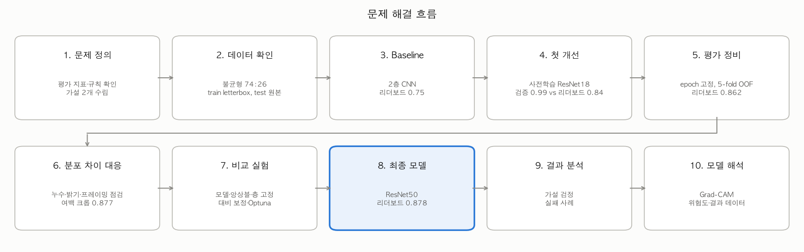
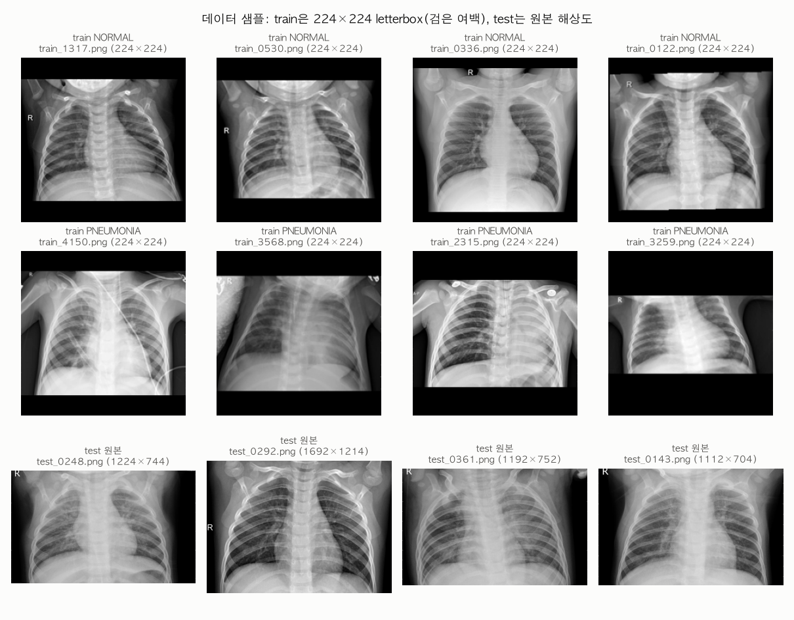
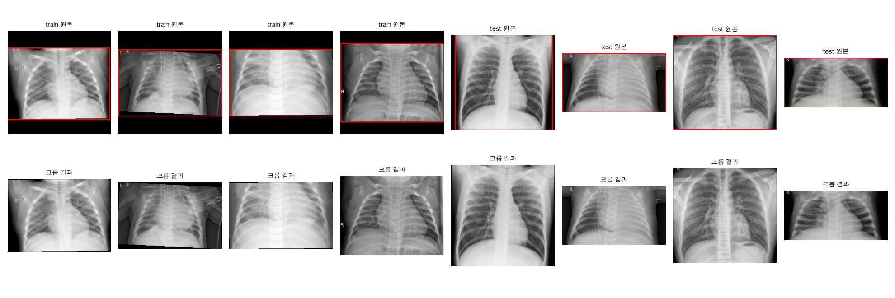
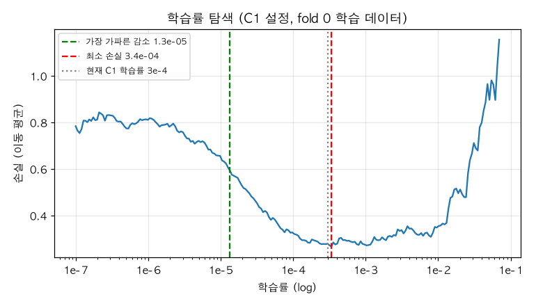
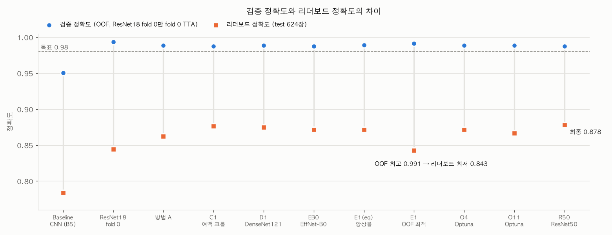
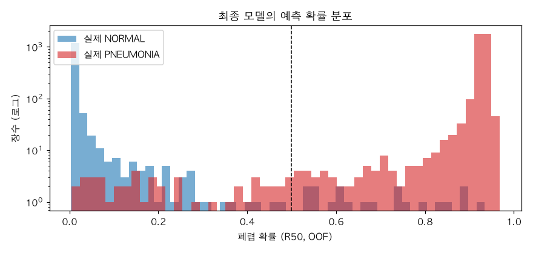
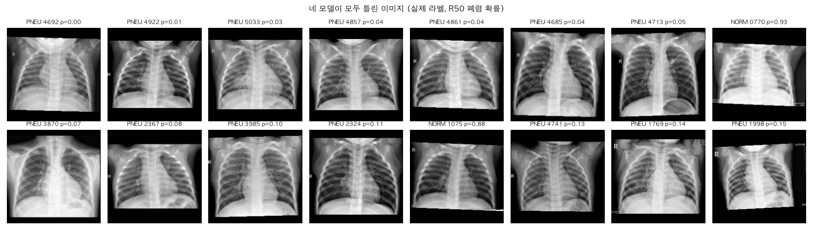
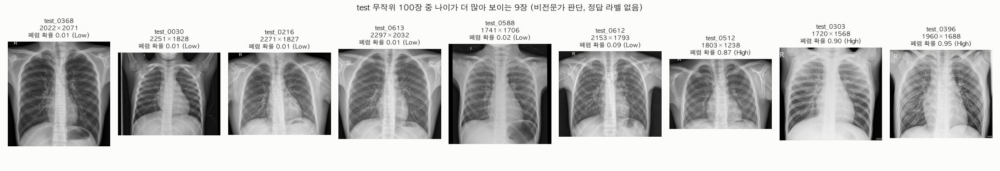
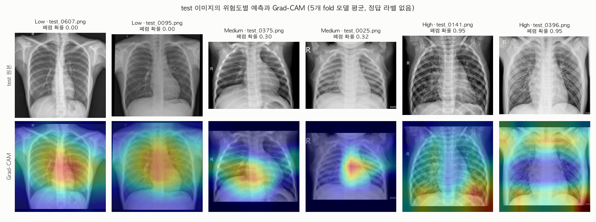

# 흉부 X-ray 이미지 분류 프로젝트 최종 보고서

## 요약

* **과제**: 소아 흉부 X-ray를 정상(NORMAL)과 폐렴(PNEUMONIA)으로 분류하는 딥러닝 모델 개발. 평가 지표는 리더보드 정확도(test 624장)이다.
* **목표**: 리더보드 정확도 0.98 이상
* **결과**: Baseline 0.75(468장)에서 최종 모델 0.8782(548장)로 80장을 더 맞혔다. 목표에는 약 64장 부족해 달성하지 못했다. 대신 검증과 리더보드의 차이에 대한 가능한 설명을 데이터 점검, 통계 검정, Grad-CAM으로 찾았다.
* **최종 모델**: ImageNet 사전학습 ResNet50, 검은 여백 크롭 후 letterbox 224×224, 5-fold 모델 확률 평균
* **핵심 발견**
  1. 검증 정확도는 0.98\~0.99인데 리더보드는 0.84\~0.88로, 어떤 방법을 써도 이 차이가 줄지 않았다. 검증에서 좋아 보이는 변경이 test에서는 오히려 점수를 낮춘 경우가 여러 번 있었다.
  2. Grad-CAM으로 보니 모델은 폐렴을 판단할 때 폐보다 어깨, 촬영 표시, 배, 이미지 가장자리 같은 폐 바깥의 단서를 많이 쓰는 경향을 보였다. 이런 지름길 단서는 검증과 test의 차이를 설명할 수 있는 가능한 설명 중 하나이며, 원인으로 확정하지는 못했다.
  3. 개선된 전체 파이프라인(사전학습 ResNet50, 전처리, 증강, 학습 설정)은 Baseline CNN보다 통계적으로 크게 나았지만(McNemar p≈10⁻³⁵), 이후의 모델 교체, 증강, 앙상블, 하이퍼파라미터 조정은 검증에서 유의한 차이를 만들지 못했다.

*그림 1. 문제 해결 흐름. 각 단계의 결과가 다음 단계의 결정으로 이어졌다.*

---

## 1. 문제 정의

### 1.1 과제와 규칙

* 입력은 흉부 X-ray 이미지이고, 출력은 정상(0) 또는 폐렴(1)이다.
* 평가는 test 624장의 정확도이며, 리더보드는 하루 10회까지 제출할 수 있다.
* 외부 데이터 사용과 test 데이터를 학습에 쓰는 것은 금지되어 있다. test는 제출 파일 생성에만 쓸 수 있다.

### 1.2 데이터를 보고 확인한 사실

모델을 고르기 전에 train과 test 이미지를 직접 열어 비교했다. 아래 사실 중 이미지 형태와 연령은 통계 요약만으로는 드러나지 않았고, 이미지를 직접 보고서야 알게 되었다.

| 항목 | 내용 |
|---|---|
| train | 5,216장. NORMAL 1,341장(25.7%), PNEUMONIA 3,875장(74.3%) |
| test | 624장. 라벨 없음 |
| train 이미지 형태 | 모두 224×224 흑백. 원본 비율을 유지하고 위아래(또는 좌우)를 검은색으로 채운 letterbox 형태 |
| test 이미지 형태 | 원본 해상도(가로 약 1,000\~2,300픽셀)가 제각각이고 검은 여백이 없음 |
| 대상 | 소아 X-ray로 보임 (아래 점검 참고) |

*그림 2. 데이터 샘플. train은 224×224 정사각형에 검은 여백이 있고, test는 원본 비율과 해상도가 제각각이다.*

**소아 데이터 점검**: 실험 도중 이미지를 보다가 모두 아이의 흉부처럼 보인다는 점을 알아차렸다. 추측으로 단정하지 않기 위해 데이터 출처 페이지를 직접 확인하고, 무작위 200장과 특징 공간의 이상치 50장을 눈으로 확인했다. 작은 흉곽, 수평에 가까운 갈비뼈, 팔을 든 고정 자세, AP 촬영 표시 같은 소아의 특징이 공통으로 보였고 성인으로 보이는 이미지는 없었다(비전문가 판단). 무작위 200장 중 성인이 0장이므로 성인 비율은 95% 신뢰수준에서 약 1.5% 미만이다. 출처로 추정되는 공개 데이터셋 페이지에는 연령 정보가 없어서, 근거는 이 점검 결과뿐이다. 같은 방식으로 test도 점검했는데, train과 달리 나이가 더 많아 보이는 이미지가 섞여 있었다(8.2절).

데이터 확인으로, 두 가지 문제를 처음부터 예상할 수 있었다. 첫째, PNEUMONIA가 74%라 모두 폐렴으로 찍어도 정확도가 약 74%가 된다. 정확도 하나로는 모델이 실제로 학습했는지 알기 어렵다. 둘째, train과 test의 이미지 형태가 달라서 같은 전처리를 하지 않으면 입력 분포가 어긋난다.

### 1.3 가설과 접근 방식

Baseline 코드를 읽고 다음 두 가설을 세웠다.

* **가설 1 (입력 처리)**: 비율을 유지하는 전처리를 train과 test에 똑같이 적용하면, 128×128 강제 Resize보다 정확도가 높아진다.
* **가설 2 (모델과 학습)**: ImageNet 사전학습 모델로 충분히 학습하면, 2층 CNN을 2 epoch 학습한 Baseline보다 정확도와 AUC가 높아진다.

평가 지표는 대회 기준인 정확도로 정하고, 불균형 데이터에서 모델의 구분 능력을 보기 위해 AUC와 클래스별 지표(민감도, 특이도)를 함께 보기로 했다. 판정 임계값은 0.5로 고정하고, test 결과를 보고 바꾸지 않는다는 원칙을 정했다.

계획한 흐름은 "데이터 확인 → Baseline 기록 → 검증 체계 구축 → 전처리 개선 → 모델 변경 → 결과 분석"이었다.

---

## 2. 출발점: Baseline과 그 한계

Baseline은 흑백 128×128 강제 Resize, 2층 합성곱 신경망, Adam 2 epoch, 검증 없음이었다. 리더보드 점수는 0.75(약 468장)였다.

Baseline의 한계는 네 가지로 정리했다.

1. 검증 과정이 없어서 성능을 리더보드로만 알 수 있다.
2. 128×128 강제 Resize는 원본 비율이 제각각인 test 이미지를 왜곡한다.
3. 모델이 작고 2 epoch만 학습해 과소적합 가능성이 크다.
4. 클래스 불균형(74:26)을 고려하지 않는다.

또 Baseline은 test를 NORMAL 57%로 예측했는데, train의 NORMAL은 26%였다. 처음부터 test에서 예측이 크게 흔들린다는 신호가 있었다.

---

## 3. 전략 선택

두 가지 전략을 세웠다.

| 전략 | 세부 방법 | 개선 대상 | 해결하려는 문제 |
|---|---|---|---|
| 1. 데이터 전처리 | letterbox, 검은 여백 크롭, 범위를 작게 잡은 증강 | 데이터 | train과 test의 입력 형태 차이, 적은 데이터 |
| 2. 모델 변경 | ResNet18, DenseNet121, 앙상블 | 모델 | 단일 구조의 한계, 분포 변화에 대한 안정성 |

공통 학습 설정으로 클래스 가중치, label smoothing 0.05, AdamW + Cosine LR을 썼다.

증강 범위는 흉부 X-ray의 해부학적 구조를 해치지 않도록 작게 잡았다(회전 ±10°, 이동 6%, 확대·축소 0.9\~1.1, 밝기·대비 ±20%). 좌우 반전은 심장 위치와 'R' 표시가 뒤집히므로 쓰지 않았다.

제외한 전략과 이유도 정했다. ViT는 데이터가 적어 불리하고, 해상도 확대는 train 원본이 224×224라 새 정보가 없다. 병변 ROI 크롭은 병변 좌표가 없어서, 외부 폐 분할 모델은 외부 데이터 규칙 때문에 쓰지 않았다.

---

## 4. 실험 과정: 결과를 보고 다음 결정을 내린 흐름

### 4.1 첫 개선: 검증 점수와 리더보드의 차이 발견

ImageNet 사전학습 ResNet18에 letterbox, 증강, 클래스 가중치를 적용하고 5-fold 중 fold 0만 학습했다. 검증 정확도는 0.9933(최고 epoch 모델에 TTA 적용)까지 올랐지만, 리더보드는 0.84455였다.

검증 0.99와 리더보드 0.84의 차이가 이번 과제 전체의 핵심 문제가 되었다. 점수를 더 올리는 방법을 찾기 전에, 지금의 검증 점수를 믿을 수 있는지부터 확인하기로 했다. 먼저 의심한 것은 평가 방식이었다. 검증 점수가 가장 높은 epoch를 골라 그 점수를 보고했기 때문에 점수가 부풀려졌을 수 있었다.

### 4.2 평가 방식 정비 (방법 A)

early stopping을 없애고 12 epoch로 고정했다. 5개 fold를 모두 학습해 각 이미지를 학습에 쓰지 않은 모델로 예측한 OOF(Out-of-Fold) 점수를 보고했다. test는 5개 모델의 확률을 평균했다.

OOF 정확도는 0.9885, 리더보드는 0.8622(+11장)였다. 그런데 같은 fold 0에서 TTA 없이 비교하면 최고 epoch 선택(0.9923)과 고정 epoch(0.9914)의 차이는 0.001뿐이었다(4.1절의 0.9933은 같은 최고 epoch 모델에 TTA를 적용한 값이라 평가 방식이 다르다). 평가 방식만으로는 차이를 설명할 수 없었다. 그래서 원인을 **train과 test의 분포 차이**로 보고 다음 실험을 설계했다.

### 4.3 분포 차이 확인과 대응

분포 차이를 확인하기 위해 세 가지를 점검했다.

* **누수 점검 (최근접 이웃)**: 검증 이미지가 학습 이미지와 중복되어 검증 점수가 부풀려졌을 수 있었다. 특징 벡터를 중심화한 유사도는 검증 0.946, test 0.942로 비슷했고, 픽셀 상관계수 0.98 초과 비율은 검증 3.9%, test 7.2%였다. 중복의 증거는 없었다. 다만 같은 환자의 다른 촬영본까지는 확인할 수 없었다.
* **밝기 차이**: 전처리 후 train과 test의 평균 밝기(0.342 대 0.333)와 대비가 거의 같았다. 단순한 밝기 차이로는 설명되지 않았다.
* **프레이밍 차이**: train은 검은 여백이 있어서 내용 비율이 0.663이고, test는 0.953이었다.

이를 바탕으로 실험했다.

* **S4 (밝기·대비 증강 확대)**: 검증에서 효과가 없었다(OOF +3장, p=0.66).
* **C1 (검은 여백 크롭)**: 임계값을 train에서만 정하고(T=10, 안정 구간 0\~10에서 결과 동일) train과 test에 같은 규칙을 적용했다. 크롭 후 train의 내용 비율이 0.927로 test에 가까워졌다. OOF는 차이가 없었지만(p=0.61), 리더보드는 0.8766으로 9장 올랐다.

*그림 3. 여백 크롭 검증. 빨간 사각형이 크롭 영역이다. train은 검은 여백만 잘리고, test는 여백이 없어 거의 그대로 유지된다.*

* **P1 (퍼센타일 대비 보정)**: C1이 정상을 폐렴으로 잘못 본 이미지는 폐가 뿌옇게 보였다. 대비를 맞추면 줄어들 것으로 기대했지만, 정상 오판정이 오히려 13장에서 18장으로 늘었다.

**정리**: 세 가지 점검 중 실제로 차이가 확인된 것은 프레이밍뿐이었다. 이를 직접 줄인 여백 크롭(C1)만 효과가 있었다. 리더보드가 0.8622에서 0.8766으로 9장 올랐고, 바뀐 9장은 모두 폐렴에서 정상으로 판정이 바뀐 경우였다(5.2절). 밝기와 대비를 다룬 S4와 P1은 효과가 없거나 오히려 나빠서 채택하지 않았다. 그래서 C1(여백 크롭 + letterbox)을 이후 모든 실험의 새 기준으로 삼았다. 하지만 OOF 0.9877과 리더보드 0.8766의 차이는 여전히 약 0.11이었다. 프레이밍은 분포 차이의 일부만 설명했고, 남은 차이의 원인은 이 단계에서 찾지 못했다.

### 4.4 모델 구조와 결합

C1에서 실험을 마칠 수도 있었다. 하지만 남은 차이가 모델 구조의 한계인지 데이터의 문제인지 확인하지 않으면 결과를 설명할 수 없다고 판단해, C1을 기준으로 백본만 바꿨다. 비용이 큰 모델은 fold 0에서 먼저 확인하고, 차이가 보일 때만 5-fold로 넓혔다.

* DenseNet121(D1)은 폐렴을 덜 놓쳤지만(FN 38) 정상 오판정이 늘었다(FP 21). 리더보드 0.8750.
* EfficientNet-B0(EB0)는 리더보드 0.8718이었다.
* ResNet50(R50)은 fold 0에서 3장 높아 5-fold로 넓혔지만, 5-fold 전체에서는 C1과 차이가 없었다(p=1.0). 리더보드는 0.8782로 C1보다 1장 높았다.

ResNet18과 DenseNet121을 앙상블했다. 가중치와 임계값은 OOF로만 골랐다. OOF 최적 설정(DenseNet 가중치 0.8, 임계값 0.3)은 OOF 정확도 0.9912로 가장 높았고, 같은 데이터로 고른 낙관을 피하려고 중첩 검증도 했다(0.9902). 그런데 리더보드는 0.8429로 가장 낮았다. 동일 가중 앙상블도 0.8718로 C1보다 낮았다. **이 결과를 계기로 점수를 더 쫓기보다, 변경에 따라 test 예측이 어느 방향으로 바뀌었는지를 분석하기 시작했다**(5.2절).

### 4.5 하이퍼파라미터와 미세조정 범위 조정

* **일부 층 고정**: 사전학습 특징을 지키기 위해 앞쪽 층을 고정했다. layer2까지 고정(F1)은 OOF가 조금 높았고(p=0.30), layer3까지 고정(F2)은 폐렴을 더 놓쳤다.
* **학습률 탐색(LR range test)**: 손실이 최소인 학습률은 3.4e-4로, 현재 3e-4가 안정 구간의 끝에 있었다.

*그림 4. 학습률 탐색. 손실이 가장 가파르게 줄어드는 지점(1.3e-5)과 최소 지점(3.4e-4), 현재 학습률(3e-4)*

* **Optuna 탐색**: fold 0에서 학습률, weight decay, label smoothing, epoch를 20회 탐색했다. 목표로 삼은 log loss가 label smoothing이 작을수록 유리한 지표라는 함정을 발견했다. 학습률은 1e-4\~3e-4가 적절했고, 7 epoch로도 충분했다. 상위 두 조합(O4, O11)을 5-fold로 다시 확인했지만 C1과 차이가 없었고, 리더보드는 오히려 낮았다.

**정리**: 네 가지 변형(F1, F2, O4, O11) 모두 검증에서 C1과 유의한 차이가 없었다(McNemar p=0.30\~0.75). 리더보드에 제출한 O4(0.8717)와 O11(0.8669)은 C1(0.8766)보다 낮았다. 두 조합은 C1보다 test를 폐렴으로 더 많이 예측했는데, 5.2절의 패턴처럼 이 변화는 모두 손해였다. 그래서 학습 설정은 C1의 것(학습률 3e-4, 12 epoch, 전체 층 학습)을 그대로 유지했다. 시험한 학습 설정 변경으로는 검증과 리더보드의 차이가 줄지 않았다. 시험하지 않은 설정까지 원인에서 배제할 수는 없다.

### 4.6 실험 관리와 누수 방지

* 모든 실험은 같은 5-fold 분할(seed 42)로 비교했고, 변경점은 하나씩 두었다. 차이가 우연인지 McNemar 검정으로 확인했다.
* 임계값 0.5는 고정했고, 크롭 임계값·앙상블 가중치·하이퍼파라미터는 train의 검증 데이터로만 정했다. test 라벨은 쓰지 않았다.
* 방법을 바꿀 때마다 새 노트북을 만들어 이전 실험을 덮어쓰지 않았다. 효과가 없던 시도는 정리하고, 의미 있는 흐름만 문서에 남겼다.
* 실험마다 노트북과 결과 파일을 따로 두고 `실험기록.csv`에 기록했다.
* 데이터 출처로 추정되는 공개 데이터셋이 있었지만 내려받지 않았다. 원본에는 test 정답이 들어 있기 때문이다.
* **리더보드 사용 범위**: test 이미지는 학습, 임계값, 하이퍼파라미터, 앙상블 가중치 결정에 쓰지 않았다. 다만 리더보드 점수는 세 곳에서 썼다. ① 최종 제출 파일 선택(R50, 6.1절), ② 가설 1 검정(6.2절), ③ 예측이 바뀐 방향과 점수 변화를 함께 본 해석(5.2절)이다. ②와 ③은 리더보드 점수로 test 일부의 정답 분포를 추론한 것이므로, "test는 제출 파일 생성에만 쓴다"는 원칙을 엄격히 적용하면 그 범위를 넘는다. 이 분석 결과로 모델이나 임계값을 바꾸지는 않았지만, 해석에 영향을 준 만큼 결과를 리더보드 기반의 사후 분석으로 구분해 읽어야 한다.

---

## 5. 실험 비교 결과

### 5.1 전체 실험

| 단계 | 변경점 | OOF 정확도 | OOF AUC | FN | FP | 리더보드 (맞힌 장수) |
|---|---|---|---|---|---|---|
| Baseline | 2층 CNN | - | - | - | - | 0.75 (468) |
| ResNet18 fold 0 | 사전학습, letterbox, 최고 epoch 선택 | 0.9933 (fold 0, TTA) | 0.9986 | - | - | 0.84455 (527) |
| 방법 A | 12 epoch 고정, 5-fold 평균 | 0.9885 | 0.9991 | 47 | 13 | 0.8622 (538) |
| S4 | 밝기·대비 증강 확대 | 0.9891 | 0.9991 | 45 | 12 | 미제출 |
| C1 | 검은 여백 크롭 | 0.9877 | 0.9991 | 51 | 13 | 0.8766 (547) |
| D1 | DenseNet121 | 0.9887 | 0.9981 | 38 | 21 | 0.8750 (546) |
| E1(eq) | C1 + D1, 동일 가중 | 0.9893 | 0.9990 | 40 | 16 | 0.8718 (544) |
| E1 | C1 + D1, OOF 최적 | 0.9912 | 0.9986 | 21 | 25 | 0.8429 (526) |
| F1 | layer2까지 고정 | 0.9893 | 0.9986 | 43 | 13 | 미제출 |
| F2 | layer3까지 고정 | 0.9864 | 0.9989 | 59 | 12 | 미제출 |
| P1 | 퍼센타일 대비 보정 | 0.9872 | 0.9992 | 49 | 18 | 미제출 |
| EB0 | EfficientNet-B0 | 0.9877 | 0.9992 | 51 | 13 | 0.8718 (544) |
| O4 | Optuna 시도 4 | 0.9883 | 0.9992 | 43 | 18 | 0.8717 (544) |
| O11 | Optuna 시도 11 | 0.9887 | 0.9992 | 42 | 17 | 0.8669 (541) |
| **R50** | **ResNet50 (최종)** | 0.9875 | 0.9985 | 46 | 19 | **0.8782 (548)** |

* 방법 A 이후의 변형은 모두 직전 기준과 비교해 McNemar p가 0.30 이상이었다(근거: `analysis/mcnemar_results.csv`).

*그림 5. 리더보드에 제출한 실험의 검증 정확도(파랑 원)와 리더보드 정확도(주황 사각형). 모든 실험에서 0.1 이상의 차이가 유지되었고, OOF가 가장 높은 앙상블이 리더보드는 가장 낮았다.*

### 5.2 검증에서 좋아 보인 변경이 test에서 손해였던 패턴 (리더보드 기반 사후 분석)

C1을 기준으로 test 예측이 한 방향으로만 바뀐 경우를 모으면 일관된 패턴이 보인다. 이 표는 제출한 파일들의 예측 차이와 공개 리더보드 점수를 결합한 것으로, test 일부의 정답을 간접적으로 추론하는 분석이다(4.6절 참고).

| 비교 | NORMAL → PNEUMONIA | PNEUMONIA → NORMAL | 리더보드 증감 |
|---|---|---|---|
| 방법 A → C1 | 0 | 9 | +9 |
| C1 → E1(eq) | 3 | 0 | -3 |
| C1 → E1 | 21 | 0 | -21 |
| C1 → O4 | 3 | 0 | -3 |
| C1 → O11 | 6 | 0 | -6 |

리더보드 증감의 크기가 바뀐 장수와 같으므로, 폐렴 판정을 늘린 변경에서 바뀐 이미지는 모두 틀렸고, 정상 판정을 늘린 변경에서 바뀐 이미지는 모두 맞은 것으로 추론된다. 검증에서는 놓친 폐렴(FN)을 줄이는 변경이 좋아 보였지만, test에서는 같은 방향이 손해였다. 이 결과를 보고 임계값을 조정하면 리더보드에 맞추는 것이 되므로 조정하지 않았다. 점수를 몇 장 올리는 것보다, 검증으로 고른 모델이 실제로 믿을 만한지가 더 중요하다고 보았기 때문이다. 대신 이 패턴을 설명할 원인을 찾기 위해 실패 사례 분석과 Grad-CAM으로 넘어갔다.

---

## 6. 최종 모델과 가설 검정

### 6.1 최종 모델

* **구조**: ImageNet 사전학습 ResNet50, 전체 층 학습, 분류층만 2클래스로 교체
* **전처리**: 검은 여백 크롭(임계값 10) 후 letterbox 224×224
* **학습**: 증강(회전 ±10°, 이동 6%, 확대·축소 0.9\~1.1, 밝기·대비 ±20%), 클래스 가중치, label smoothing 0.05, AdamW(3e-4) + Cosine LR, 12 epoch
* **예측**: 5개 fold 모델 확률 평균, 약한 TTA, 임계값 0.5
* **성능**: OOF 정확도 0.9875, AUC 0.9985, 리더보드 0.8782
* **선정 이유**: 대회 규칙에 따라 최종 채점 파일을 직접 고르는 단계에서, 공개 리더보드 점수가 가장 높은 파일을 골랐다. 다만 검증에서는 ResNet18(C1)과 차이가 없었고(p=1.0) 리더보드 차이도 1장이므로, 이 선택은 공개 리더보드에 맞춘 선택일 수 있다. 검증 기준으로는 C1과 R50이 같은 수준이다.

### 6.2 가설 검정

가설을 검정하려면 Baseline도 같은 fold의 OOF 예측이 필요해서, Baseline CNN을 5-fold로 다시 학습했다(강제 Resize B5, letterbox B5L).

| 가설 | 비교 | 한쪽만 맞힌 장수 | McNemar p | 결론 |
|---|---|---|---|---|
| 가설 1 (입력 처리) | B5 vs B5L (리더보드) | 106 vs 100 | 0.73 | H0 기각 못 함 |
| 가설 2 (모델과 학습) | B5 vs R50 (OOF) | 35 vs 227 | 1.3×10⁻³⁵ | H0 기각 |

* 가설 1은 검정 방법부터 고민이 필요했다. 이 검정은 리더보드 점수에 기반하므로 4.6절에서 밝힌 사후 분석에 해당한다. train 이미지가 이미 정사각형이라 두 전처리가 train에서는 결과가 같고, test에서만 206장의 예측이 달랐다. 정답이 두 가지뿐이라 예측이 다른 이미지에서는 반드시 한쪽만 맞으므로, 리더보드 점수 차이로 McNemar 검정을 할 수 있었다. 결과적으로 letterbox만으로는 정확도가 오르지 않았다.
* 가설 2는 매우 강하게 지지되었다. 다만 B5와 R50은 사전학습 여부만이 아니라 모델 구조, 전처리(여백 크롭, 224 해상도), 증강, 학습 설정이 함께 다르다. 따라서 이 결과는 "사전학습 모델 단독의 효과"가 아니라 "개선된 전체 파이프라인이 Baseline보다 낫다"는 근거로 해석해야 한다.

---

## 7. 실패 사례 분석

### 7.1 Before vs After

| 지표 | Baseline CNN (B5) | 최종 R50 |
|---|---|---|
| 정확도 | 0.9507 | 0.9875 |
| 민감도 (폐렴을 찾은 비율) | 0.9636 | 0.9881 |
| 특이도 (정상을 맞힌 비율) | 0.9135 | 0.9858 |
| 놓친 폐렴 (FN) | 141 | 46 |
| 정상 오판정 (FP) | 116 | 19 |

*그림 6. 혼동행렬 비교. 왼쪽이 Baseline CNN, 오른쪽이 최종 모델 R50이다(OOF, 5,216장).*

### 7.2 어떤 이미지를 틀리는가

* **확신의 정도**: 확률이 0.1 미만 또는 0.9 초과인 예측이 94.8%이고 정확도는 99.7%이다. 0.1\~0.9 사이의 애매한 예측 271장은 정확도가 80.8%이다.

*그림 7. 최종 모델의 예측 확률 분포(세로축 로그). 대부분의 이미지가 0 또는 1 근처에 모여 있다.*

* **확신을 갖고 놓친 폐렴**: 놓친 폐렴 46장 중 12장은 확률이 0.1 미만이다. 임계값을 바꿔도 잡기 어렵다.
* **구조와 관계없는 오류**: 네 모델(ResNet18, DenseNet121, EfficientNet-B0, ResNet50)이 모두 틀린 이미지가 27장이고, 그중 23장이 놓친 폐렴이다. 이 이미지들은 폐가 비교적 어둡고 선명해서 정상처럼 보인다.

*그림 8. 최종 모델의 실패 사례. 위 줄은 확신을 갖고 놓친 폐렴, 아래 줄은 확신을 갖고 폐렴으로 판정한 정상이다(p는 폐렴 확률).*

*그림 9. 네 모델이 모두 틀린 이미지. 대부분 실제 폐렴인데 폐가 선명하게 찍힌 이미지이다.*

* **수치로 본 패턴 (탐색 분석)**: 오류 이미지와 맞힌 이미지(정상·폐렴 각 무작위 300장)를 네 가지 특징(평균 밝기, 대비, 폐 영역 밝기, 내용 비율)으로 비교했다(Mann-Whitney, 두 비교 × 네 특징 = 8회 검정). 정상 오판정 이미지는 맞힌 정상보다 폐 영역이 밝고(p=0.03) 내용 비율이 낮았다(p=0.02). 놓친 폐렴 이미지는 맞힌 폐렴보다 대비가 높고(p=0.009) 흉곽이 프레임을 더 채웠다(p<0.001). p값은 다중 비교 보정 전 값이며, Bonferroni 보정(기준 0.05/8≈0.006)을 적용하면 놓친 폐렴의 내용 비율 차이만 남는다. 모델이 밝기와 프레이밍 단서에 의존할 수 있다는 탐색적 신호로만 해석한다.

---

## 8. 모델 해석 (Grad-CAM)

### 8.1 Grad-CAM으로 본 판단 근거

실패 분석에서 본 신호를 확인하기 위해 Grad-CAM으로 모델이 어디를 보는지 확인했다. 각 train 이미지는 그 이미지를 학습에 쓰지 않은 fold 모델로 해석했다.

*그림 10. 해석 1: 확신 있게 맞힌 이미지의 Grad-CAM. 정상(TN)은 흉곽 중앙을, 폐렴(TP)은 어깨·촬영 표시·배·가장자리를 본다.*

*그림 11. 해석 2: 확신 있게 틀린 이미지의 Grad-CAM. 놓친 폐렴(FN)은 흉곽 중앙을, 정상 오판정(FP)은 아래쪽 가장자리와 배를 본다.*

| 그룹 | 흉곽 중앙 비율 | 검은 여백 비율 |
|---|---|---|
| 정상 맞힘 (TN) | 0.65 | 0.08 |
| 폐렴 맞힘 (TP) | 0.23 | 0.34 |
| 놓친 폐렴 (FN) | 0.74 | 0.05 |
| 정상 오판정 (FP) | 0.48 | 0.24 |

* 정상 판단은 흉곽 중앙(심장과 양쪽 폐)을 본다.
* 폐렴 판단은 어깨, 위쪽 모서리의 "A-P" 촬영 표시, 배, 이미지 가장자리를 보는 경우가 많다.
* 확신을 갖고 놓친 폐렴은 정상처럼 흉곽 중앙을 본다. 폐 바깥에 단서가 없는 폐렴을 정상으로 본 것이다.
* 표본: 정상 맞힘(TN)과 폐렴 맞힘(TP)은 확신 있게 맞힌 이미지 중 무작위 60장씩, 놓친 폐렴(FN)과 정상 오판정(FP)은 OOF 오류 전체(46장, 19장)를 썼다.
* 두 비교(FN 대 TP, FP 대 TN)의 두 지표 모두 Mann-Whitney p<0.001이다. 4회 비교에 Bonferroni 보정(기준 0.0125)을 적용해도 유의하다. 다만 표본 추출 방식이 그룹마다 다르고 영역이 근사이므로, 탐색적 결과로 본다.

이 결과로 이번 과제의 핵심 문제에 대한 가능한 설명을 세웠다. 모델이 폐렴 병변보다 **촬영 습관과 관련된 지름길 단서**를 학습했을 가능성이 있다. 예를 들어 누워서 찍는 AP 촬영은 아픈 아이에게 많이 쓰여 폐렴과 함께 나타날 수 있다. 같은 출처의 데이터로 나눈 검증에서는 이 단서가 그대로 통하지만, test에서는 통하지 않아 점수 차이가 생겼을 수 있다. 이 설명은 폐 영역을 가린 학습 같은 추가 실험으로 확인하지 않았으므로 원인으로 확정하지 않는다.

한계도 있다. Grad-CAM은 7×7 특징 맵을 키운 것이라 위치가 거칠고, 흉곽 중앙은 폐 마스크가 아닌 근사 영역이다. 이미지 판단은 비전문가의 육안 판단이다.

### 8.2 test 데이터의 연령 점검

검증과 test의 차이를 설명할 다른 원인이 있는지 보려고, test에서도 무작위 100장(seed 42)을 train과 같은 방식으로 눈으로 점검했다. test는 라벨 없이 이미지만 보았고, 모델이나 임계값을 정하는 데는 쓰지 않았다.

* 대부분은 소아로 보였지만, **9장은 나이가 더 많아 보였다**. 흉곽이 크고 길며 갈비뼈가 비스듬했다(비전문가 판단).
* 9/100 = 9%이고, 95% 신뢰구간은 약 4%\~16%이다. train 무작위 200장과 이상치 50장에서는 이런 이미지가 한 장도 없었다.
* 이 9장은 원본이 더 크고(가로 중앙값 2,022픽셀, 나머지 1,272픽셀) 정사각형에 가까웠다(종횡비 중앙값 1.16, 나머지 1.47).

| 이미지 | 폐렴 확률 | 예측 | 위험도 |
|---|---|---|---|
| test_0368, test_0030, test_0216, test_0613, test_0588 | 0.01\~0.02 | 정상 | Low |
| test_0612 | 0.09 | 정상 | Low |
| test_0512, test_0303, test_0396 | 0.87\~0.95 | 폐렴 | High |

*그림 12. test 무작위 100장 중 나이가 더 많아 보이는 9장. 모델은 모두 높은 확신으로 예측했지만, 정답 라벨이 없어 맞았는지는 알 수 없다.*

* 모델은 9장을 모두 0.1 미만이나 0.85 이상의 높은 확신으로 예측했다. 학습 데이터에 거의 없던 연령대인데도 확신이 높다는 점은, 높은 확신이 곧 정답이라는 뜻이 아님을 보여 준다.
* test에 나이가 많은 환자가 섞여 있다면, 흉곽 모양과 촬영 자세(서서 찍는 PA 촬영 등)가 train과 달라진다. 이것은 Grad-CAM에서 본 지름길 단서의 분포를 바꿀 수 있으므로, 검증과 test 차이의 또 다른 가능한 설명이 된다. 다만 라벨 없는 100장에 대한 비전문가의 시각 판정이어서 탐색적 관찰에 그친다.
* 정답이 없어서 이 9장의 정확도는 계산할 수 없다. 이 9장의 예측만 바꿔 제출해 정답을 알아내는 식의 추가 제출은 하지 않았다.

**소아 데이터만 있는 경우와 성인이 섞인 경우를 구분해야 하는 이유**

* **정상의 기준이 다르다.** 소아는 흉곽이 작고 둥글며 갈비뼈가 수평에 가깝고, 심장이 흉곽에서 차지하는 비율도 크다. 주로 누워서 앞뒤(AP)로 찍는다. 성인은 흉곽이 길고 갈비뼈가 비스듬하며, 주로 서서 뒤앞(PA)으로 찍는다. 소아만 보고 배운 모델에게 성인의 정상 영상은 처음 보는 형태이므로, 정상이어도 이상하게 판단할 수 있다.
* **폐렴의 모습도 다르다.** 소아와 성인은 폐렴의 흔한 원인과 영상에 나타나는 모습이 다르다고 알려져 있다. 소아 폐렴에서 배운 특징이 성인 폐렴에 그대로 통한다는 보장이 없다.
* **점수의 의미가 달라진다.** OOF 점수는 소아 데이터에서의 성능만 보여 준다. test에 성인이 섞여 있으면 리더보드 점수는 소아 성능과 성인 성능이 섞인 값이 된다. 그러면 검증과 test의 차이가 지름길 단서 때문인지 연령 차이 때문인지 나눌 수 없다. 연령별로 따로 성능을 확인해야 원인을 알 수 있다.
* **개선 방향이 달라진다.** test도 소아뿐이라면 전처리나 지름길 단서를 고치는 것이 해결책이다. 성인이 섞여 있다면 소아 데이터만으로 튜닝을 반복해도 한계가 있고, 성인 데이터를 추가하거나 연령에 따라 다르게 처리해야 한다.
* **서비스에서 쓸 수 있는 범위가 정해진다.** 이 모델은 소아 영상으로만 학습했으므로 사용 대상을 소아로 한정해야 한다. 성인 영상이 들어오면 높은 확신으로 틀릴 수 있어서, 연령 정보를 함께 받아 성인은 판독 우선순위를 높이는 등의 처리가 필요하다.

---

## 9. 서비스 확장 설계

### 9.1 저장할 결과 데이터

test 624장에 대해 이미지마다 다음 데이터를 만들었다(`analysis/m5/test_results_R50.csv`, Grad-CAM 이미지 624장).

| 항목 | 의미 |
|---|---|
| 원본 이미지 (`file_name`) | 판독 대상 영상의 식별자 |
| 예측 확률 (`prob_pneumonia`) | 5개 fold 모델 평균 폐렴 확률 |
| 예측 결과 (`pred_label`, `pred_name`) | 확률 0.5 이상이면 폐렴 |
| 위험도 (`risk_level`) | Low, Medium, High |
| Grad-CAM 이미지 (`gradcam_path`) | 판정 근거를 보여 주는 이미지 |
| 모델 버전 (`model_version`) | 어떤 모델로 예측했는지 추적 |

### 9.2 위험도 기준

예측 확률(5-fold 평균 폐렴 확률)을 두 경계로 나눠 Low, Medium, High 세 단계로 구분했다. 폐렴을 놓치지 않는 것을 우선했고, 경계는 OOF로만 정했다. 이 위험도는 판독 순서에 대한 연구용 제안이며 임상 지침이 아니다. 실제로 쓰려면 외부 데이터 검증과 의료진 확인이 먼저 필요하다.

| 위험도 | 폐렴 확률 | 경계 기준 (OOF) | 실제 폐렴 비율 (OOF 추정) | test 장수 | 제안 우선순위 (연구용) |
|---|---|---|---|---|---|
| Low | 0.10 미만 | 구간 안의 실제 폐렴 ≤ 1% | 0.9% | 110 | 일반 판독 순서 (판독 생략 아님) |
| Medium | 0.10 이상 0.49 미만 | 그 사이 | 41.6% | 50 | 우선 재확인 권고 |
| High | 0.49 이상 | 구간 안의 실제 정상 ≤ 0.5% | 99.5% | 464 | 최우선 판독 권고 |

*그림 13. test 이미지의 위험도별 예측과 Grad-CAM. 서비스 화면에서 위험도와 함께 보여 줄 판정 근거 이미지의 예시이다(test는 정답 라벨이 없다).*

**경계 설정 근거**
* 경계와 "실제 폐렴 비율"은 모두 train의 OOF 예측에서 추정한 값이다. test에는 정답이 없어 test의 구간별 비율은 알 수 없고, 분포 차이가 있으면 달라질 수 있다.
* 경계를 "전체 대비 비율"이 아니라 "구간 안의 오류율"로 정했다. 의료진에게 의미 있는 값은 "Low로 표시된 영상 중 몇 %가 실제 폐렴인가"이기 때문이다. 처음에는 "전체 폐렴 중 Low에 들어가는 비율 1% 이하"로 정했는데, 폐렴 38장까지 허용되어 Low 경계가 0.43이 되고 Medium이 8장뿐이었다. 그래서 기준을 바꿨다.
* 판정 라벨의 임계값(0.5)은 정상과 폐렴을 나누고, 위험도 경계는 판독 순서를 정한다. 둘은 역할이 다르다.

**실제 의료 서비스 기준: 민감도(Sensitivity) 우선**
* 이 모델은 진단을 대신하지 않고, 판독 대기 영상의 순서를 정하는 분류(triage) 도구로 쓴다고 가정했다. 모든 영상은 결국 전문의가 판독한다.
* 폐렴을 정상으로 놓치면(FN) 치료가 늦어지고 소아는 빠르게 나빠질 수 있다. 정상을 폐렴으로 보면(FP) 재확인 비용이 생기지만 되돌릴 수 있다. 그래서 FN을 줄이는 쪽을 택했다.
* Low 경계를 0.10으로 낮게 두어, 실제 폐렴 3,875장 중 99.7%(3,863장)가 Medium 이상으로 분류되어 우선 판독 대상이 된다. 그 대가로 실제 정상 1,341장 중 64장(4.8%)이 Medium 이상에 들어가 재확인 업무가 생긴다.
* 특이도(Specificity)를 우선해 Low 경계를 높이면 의료진 부담은 줄지만, 처음 기준(0.43)처럼 폐렴 38장이 Low에 들어간다. 선별 목적의 서비스에서는 받아들이기 어렵다.

**기준이 잘못 설정될 경우의 문제**
* Low 경계가 너무 높으면 폐렴 환자가 Low로 분류되어 판독이 늦어진다.
* High 경계가 너무 낮으면 정상이 High로 분류되어 불필요한 검사와 처방, 보호자의 불안이 늘어난다.
* Medium이 너무 넓으면 재확인 대상이 많아져 의료진이 경고에 무뎌지고(alarm fatigue), 너무 좁으면 재확인 단계가 사실상 없어진다.
* 경계는 train 분포에서 정했다. 리더보드 기반 사후 분석(5.2절)에서 test는 폐렴 판정을 늘리면 오히려 틀리는 경향을 보였으므로, 운영 환경에서는 정상이 High로 몰릴 수 있다. 운영 데이터로 경계를 다시 확인해야 한다.
* 확신을 갖고 놓친 폐렴 12장이 여전히 Low에 있다. Low는 판독 순서를 뒤로 미루는 단계이며, 판독을 생략하는 단계로 쓰면 안 된다.

---

## 10. 최종 인사이트

**1. 검증 점수는 실제 성능을 보장하지 않는다.**
모든 개선 모델이 검증 0.98\~0.99를 기록했지만 리더보드는 0.84\~0.88이었다. OOF가 가장 높은 앙상블이 리더보드는 가장 낮았다. 같은 출처에서 나눈 검증 데이터는 지름길 단서를 그대로 공유할 수 있으므로, 검증 점수만 보고 모델을 고르면 잘못된 방향으로 갈 수 있다. test에는 train에 없던, 나이가 더 많아 보이는 영상도 약 9% 섞여 있었다.

**2. 정확도가 높아도 판단 근거는 틀릴 수 있다.**
Grad-CAM이 없었다면 모델이 폐 바깥의 단서를 쓰고 있다는 것을 알 수 없었다. 의료처럼 판단 근거가 중요한 분야에서는 성능 지표와 함께 설명 가능성을 반드시 확인해야 한다.

**3. 측정 체계를 먼저 갖춰야 무엇이 효과를 냈는지 알 수 있다.**
계획은 "검증 체계 → 전처리 → 모델" 순서였지만, 실제로는 첫 개선에서 셋을 동시에 바꿨고 Baseline 점수도 나중에 기록했다. 그 결과 첫 개선의 효과를 요소별로 나눌 수 없었다. 이후에는 변경점을 하나씩 두고 McNemar 검정으로 비교했고, 그 덕분에 대부분의 변경이 우연 수준이었다는 것을 확인할 수 있었다.

**4. 하나의 fold나 한 번의 결과로 판단하면 안 된다.**
ResNet50은 fold 0에서 3장 높았지만 5-fold에서는 차이가 없었다. Optuna 상위 조합도 5-fold에서는 같은 수준이었다. 리더보드의 몇 장 차이도 표본이 작아 우연일 수 있다.

**5. 도구의 가정을 이해해야 한다.**
log loss를 목표로 한 Optuna는 label smoothing이 작은 조합만 골랐다. 학습률 탐색이 권한 1e-5 수준은 실제 학습에서 성능이 낮았다. 위험도 기준도 "전체 대비"와 "구간 안" 비율의 차이로 결과가 크게 달라졌다. 도구가 내놓은 값을 그대로 쓰지 않고, 그 값이 어떤 가정에서 나왔는지 확인하는 습관이 필요하다.

**6. 데이터를 이해하는 것이 모델을 바꾸는 것보다 중요했다.**
리더보드가 가장 크게 오른 비-모델 변경은 데이터를 들여다보고 찾은 여백 크롭이었다. 소아 데이터라는 점, train은 letterbox이고 test는 원본이라는 점, 촬영 표시와 자세가 다양하다는 점은 모두 데이터를 직접 보고 알게 된 사실이다.

---

## 11. 한계와 향후 과제

**한계**
* 목표 0.98에 도달하지 못했다(약 64장 부족).
* 최종 모델은 리더보드 1장 차이로 골랐으므로, 최종 채점이 다른 데이터로 이루어진다면 순위가 바뀔 수 있다.
* 소아 영상으로만 학습해 성인 영상에는 쓸 수 없다.
* 환자 ID가 없어 환자 단위 누수를 완전히 배제하지 못했다.
* test에 나이가 더 많아 보이는 영상이 약 9% 있었지만, 실제 나이와 정답을 알 수 없어 이 영상에서의 성능은 확인하지 못했다.
* Grad-CAM 해석과 소아 데이터 판단은 비전문가의 육안 판단이 포함되어 있다.

**향후 과제**
* 폐 영역만 남기고 폐 바깥을 가린 뒤 학습해 지름길 단서를 줄인다(폐 마스크를 대회 규칙 안에서 얻을 수 있다면).
* 촬영 표시("A-P", "R")와 장치를 가리는 전처리를 시험한다.
* 다른 병원의 데이터로 외부 검증을 한다(대회 규칙 밖에서).
* Grad-CAM이 폐 바깥에 집중하는 예측을 자동으로 표시해 전문의가 재확인하도록 한다.
* 위험도 경계를 실제 운영 데이터로 다시 맞춘다.

---

## 부록: 관련 파일

경로는 저장소 루트 기준이다.

**문서**
* `README.md`: Mission 0\~5 전체 정리와 Reflection 답변
* `docs/daily-logs/`: 단계별 데일리 로그 (M1\~M5)
* `analysis/실험기록.csv`: 실험별 OOF와 리더보드 기록

**노트북**
* `notebooks/final/R50_ResNet50_5fold.ipynb`: 최종 모델 학습과 제출 파일 생성
* `notebooks/final/Mission4_결과분석.ipynb`: 결과 분석
* `notebooks/final/Mission5_GradCAM_결과데이터.ipynb`: Grad-CAM, 위험도, 결과 데이터
* `notebooks/experiments/`: Baseline부터 각 실험(ResNet18, 방법 A, 크롭 검증, S4, C1, D1, EB0, F1, F2, P1, O4, O11, R50 fold 0)과 Baseline CNN 가설 검정

**분석 결과**
* `analysis/mcnemar_results.csv`, `analysis/mcnemar_all.py`: 실험별 McNemar 검정
* `analysis/optuna_C1.py`, `analysis/lr_range_test.py`: 하이퍼파라미터 탐색
* `analysis/age_audit/`: 소아 데이터 점검(train), test 연령 점검
* `analysis/m4/`, `analysis/m5/`: 결과 분석과 모델 해석 결과
* `report/figures/`: 보고서 그림과 생성 스크립트 `make_figures.py`
